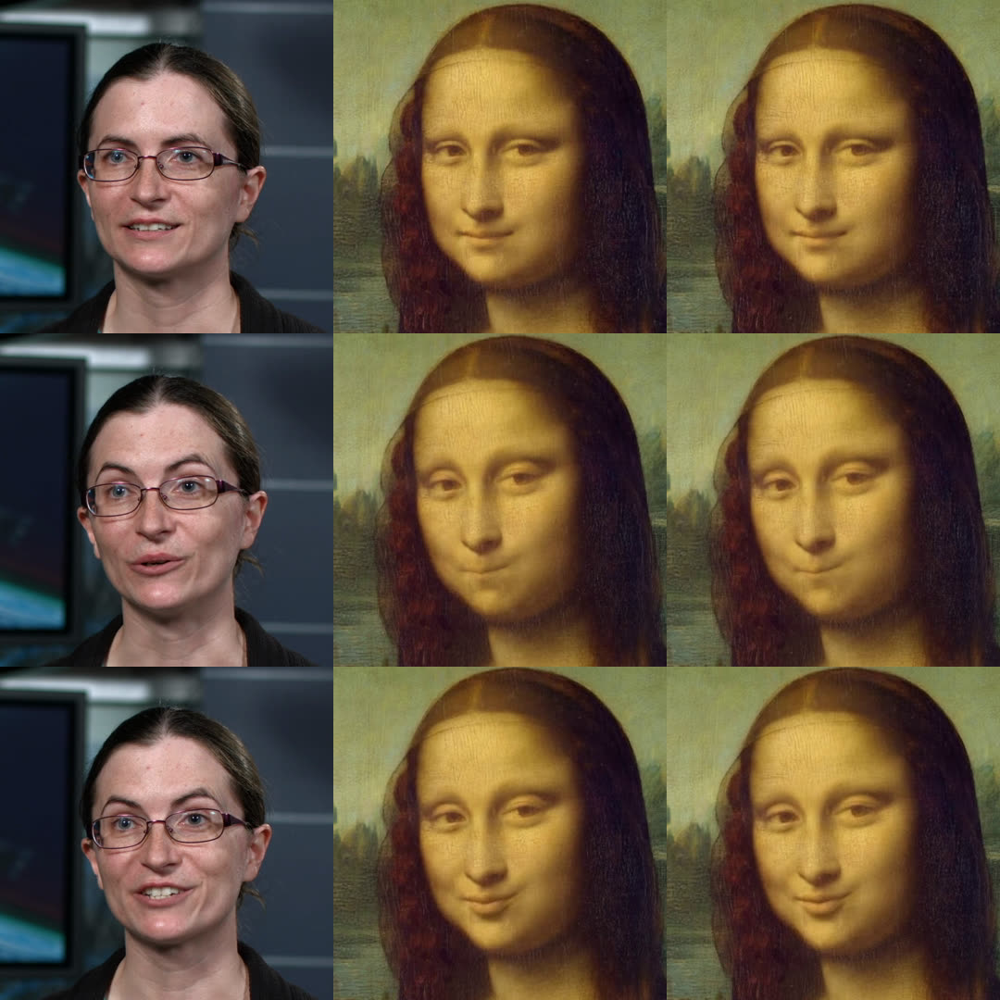
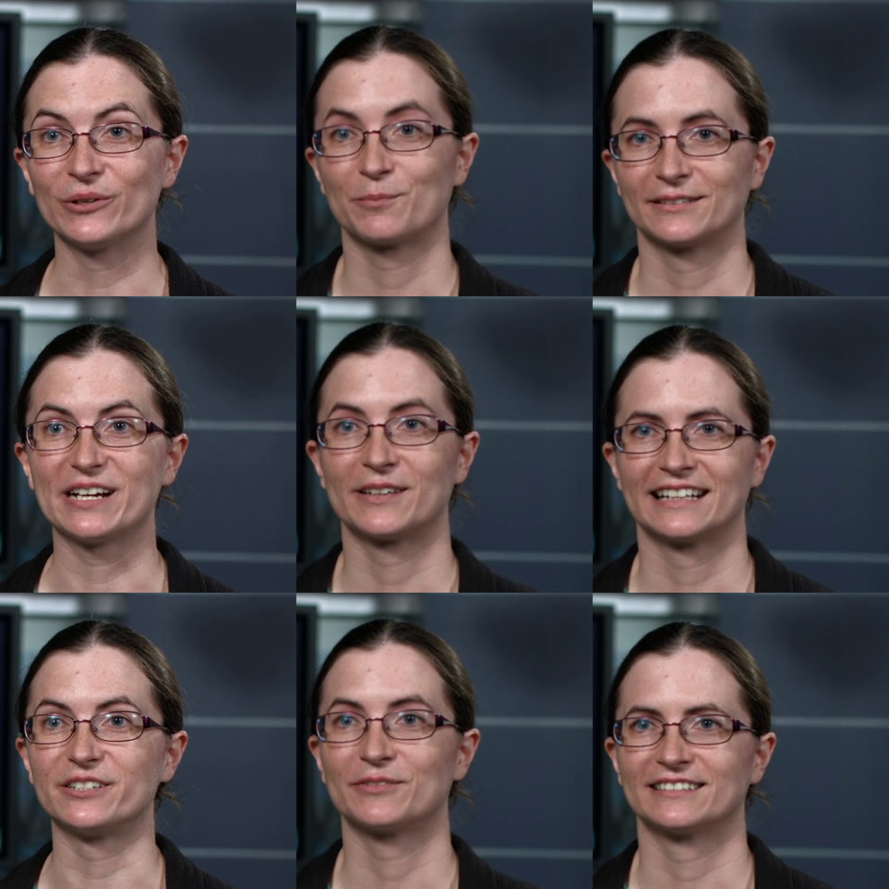

# Spike: LivePortrait on the computer (issue #242)

Date: 2026-10-25. Decision: [ADR-0026](../adr/0026-local-takes-with-liveportrait.md). Builds on: [ADR-0024](../adr/0024-local-vision-models.md), the [performance capture spec](../spec/performance-capture.md), the cost research on #241.

Performed takes cost about US$10 per finished minute in the cloud before retries. [LivePortrait](https://github.com/KwaiVGI/LivePortrait) (MIT code and weights) animates a still portrait from a driving video of a face. This spike checks whether it runs inside Bardo along ADR-0024's path (ONNX Runtime through `ort`, DirectML with the CPU fallback, no Python at run time), with MediaPipe in place of InsightFace, and how its results compare with upstream's.

The spike ran in a 4-core Linux container with no graphics card, and on GitHub's `ubuntu-latest` and `windows-latest` runners (4 vCPU, no graphics card) through the `liveportrait-spike` workflow, whose `convert.log` and JSON reports back the numbers below. Nothing here ran on a graphics card: the reference machine (Windows, 12 GB GPU) is measured with the checks at the end, on #236. Container times move by ±20 % from run to run.

## Answers

| Question (#242) | Answer |
| --- | --- |
| Does the 5-D grid_sample run on DirectML? | Not as ONNX GridSample, which DirectML registers for 4-D input only. Rewritten at conversion into Gather and arithmetic, as accurate and as fast on the CPU; whether every node then runs on DirectML is check 2 below |
| ms a frame, 30 s take | CPU: 5.8 to 9.1 s a frame, 87 to 136 min for a 30 s take, so no use without a graphics card. DirectML on the reference machine: check 3 (target: a 30 s take within 5 minutes) |
| Quality against upstream | The same: the same crops within about 2 % of the crop, the same self-reenactment error (22.1 dB on the face for both), the same pictures to the eye |
| Quality against Kling on real captures | Check 7, on your own capture |
| MediaPipe crop against InsightFace | Within 1 % of the crop's size at the center, 2 % in size, about 1° in tilt; the lip ratio reads lower and needs mapping |
| Bundle size; installer or download | 261 MB of float16 weights; downloaded on first use (ADR-0026) |
| Fit with the take model port | A local job like take analysis, not a `TakeGenerator`; Recording mode only (below) |

## What was built

No app code. `spikes/liveportrait-probe/` is a standalone crate with its own workspace and lock file, so the app's build and tests never compile it. It forbids `unsafe`, and it uses Bardo's own `bardo-vision` crate for the face (MediaPipe Face Landmarker as #190 ships it, one-euro smoothing included).

| Piece | What it does |
| --- | --- |
| `liveportrait-probe info` | Loads every network on the CPU or DirectML, runs it once, and with `--placement` reads ONNX Runtime's profile to count the nodes each execution provider ran, naming the operators left on the CPU |
| `liveportrait-probe animate` | A look animated by a take, as upstream does for a still source and a driving video (relative motion, stitching, closing the look's mouth first, paste-back): MP4 with the take's sound, an optional side-by-side, and a JSON report with the milliseconds per frame of every step. `--self` animates the take's first frame by the take and compares every result with the take's own frame; `--reference closed-mouth` measures the expression from another frame (below) |
| `src/crop.rs`, `src/motion.rs`, `src/image.rs` | Upstream's crop, keypoint and pixel arithmetic in Rust, each tested against values `tools/fixtures.py` computes with upstream's own functions |
| `tools/convert.py` | Downloads every source pinned in `models.toml` (code by commit, weights by revision and SHA-256), exports each network with `torch.onnx` and checks it against PyTorch, then keeps the weights as float16 (read back as float32) and checks again |
| `tools/reference.py` | Runs upstream itself (PyTorch, CPU, float32, its InsightFace crop) on the same look and take, for comparison |
| `tools/compare_crop.py` | Measures, frame by frame, the probe's MediaPipe crop against upstream's InsightFace one, with the MediaPipe points `src/crop.rs` uses |
| `tools/takes.py` | Fetches the test recording by SHA-256 and cuts the take |

Run it: `python tools/convert.py models --fp16`, `python tools/takes.py takes ../../.ffmpeg/bin/ffmpeg`, `cargo xtask fetch-models` at the repository's root, then from `spikes/liveportrait-probe`: `cargo run --release -- animate --models models --vision ../../.models --take takes/take-head-20s.mp4 --look looks/mona-lisa.jpg --out out.mp4`.

The probe reads a phone's rotated recording upright and at a constant frame rate, measures motion from the first frame with a face, and closes the look's mouth first when its lips are apart (upstream's pipeline default; its command line leaves that off). It always crops the take to the face, where upstream feeds a square take whole.

## Test inputs

- **Take**: 20 s of the NASA Goddard interview the vision spike used (public domain), 1080p30, in one shot with its sound: a seated speaker facing the camera, talking, wearing glasses.
- **Looks**: the *Mona Lisa* and *Girl with a Pearl Earring* (public domain paintings, committed in `looks/`, 768 × 768). Painted looks stand in for a drawn persona; the second has the head turned three quarters.
- **Self-reenactment**: the take's first frame as the look, driven by the take. The truth is known (the take's own frames), so it gives a number for quality that does not depend on taste, for the probe and for upstream alike.

## Converting the networks

Upstream's code at commit `9b294b3`, weights from Hugging Face (`KlingTeam/LivePortrait`, the repository's new name) at revision `82a4fa6`. Each network is exported on its own, so the probe can time each one. Every export matches PyTorch within 6·10⁻⁶ of the output's range. Float16 weights (read back as float32, as `crates/vision` ships its models) stay within 10⁻³ of the float32 file, except the motion extractor's angle bins at 2.5·10⁻³, which move the head angles by 0.002° (`convert.log`).

| File | Size (float16 weights) | Input → output |
| --- | --- | --- |
| `appearance_feature_extractor.onnx` | 1.7 MB | look crop 256² → feature volume 32 × 16 × 64 × 64 |
| `motion_extractor.onnx` | 56.4 MB | crop 256² → head angles (66 bins each), shift, expression, scale, 21 keypoints |
| `warping_module.onnx` | 91.4 MB | feature volume and both keypoint sets → warped features 256 × 64²; 5-D `grid_sample` rewritten (below) |
| `warping_module_gridsample.onnx` | 91.4 MB | the same with ONNX's own GridSample (opset 20) |
| `spade_generator.onnx` | 110.9 MB | warped features → face 512² |
| `stitching.onnx`, `retarget_lip.onnx`, `retarget_eye.onnx` | 0.5 MB together | small MLPs on the keypoints |

- **Shipping size: 261 MB** with one warping module (522 MB as float32).
- **Float16 compute.** `--fp16` also writes `*_fp16.onnx` copies of both warping modules and the generator that compute in float16 (inputs and outputs float32), for DirectML, each checked against its float32 file: the warping modules within 7·10⁻³ of the range, the generator within 6·10⁻⁴. On the CPU they run but are no faster (the generator's copy 5.1 s a frame against 5.0 s on `ubuntu-latest`); check 4 says whether DirectML gains from them. They would replace the matching files, not add to them.
- **Spectral norm.** The generator's SPADE blocks keep their convolutions under spectral norm. Exported as is, the file carried each weight twice and divided at run time (172 MB in float16); folding the norm in first gives the same output in 111 MB.
- **Eval mode.** `torch.onnx.export` puts a module back in the mode it found it in. A wrapper made in training mode left the BatchNorm layers inside it on batch statistics after the first export, and the next export of the same network came out wrong (caught by the check against PyTorch). `convert.py` puts every module in eval mode first.
- **Reproducible.** Two runs in the container wrote byte-identical ONNX files, so a re-conversion can be checked by SHA-256.

## The 5-D grid_sample

The warping module samples 3-D feature volumes twice with `F.grid_sample` (trilinear, zero padding): 22 volumes of 4 × 16 × 64 × 64 in the dense motion network, then the 32 × 16 × 64 × 64 volume. ONNX only takes 5-D input to GridSample from opset 20; DirectML's execution provider registers GridSample for 4-D input, so on DirectML these nodes would run on the CPU, with the volumes copied across each frame.

`convert.py` therefore also rewrites both calls into Gather and arithmetic: the volume is laid out a voxel per row, and one Gather reads the eight corners of every sample with all their channels; the voxel indices are built in int64 (as floats they would pass float16's largest value in the float16 copy), and the weights and the zero padding come from the grid with Floor, comparisons and casts.

- **Accuracy**: the rewritten module matches PyTorch's own `F.grid_sample` within 5·10⁻⁶ of the range, as the GridSample export does.
- **Speed on the CPU**: the same within noise (warping 2.6 s against 2.5 s a frame on `ubuntu-latest`, 3.4 s against 3.2 s on `windows-latest`), as the 3-D convolutions take most of the time.
- **On DirectML**: unmeasured here. On the Windows runner DirectML found no device and every network fell back to the CPU, recording why, as it should. `info --ep directml --placement` on the reference machine says which nodes of each file stay on the CPU, and `animate` with each `--warp` times them.

## Speed

Milliseconds a frame, CPU only, first 30 frames of the take, Mona Lisa look (768 × 768):

| Step | Container (4 cores) | `ubuntu-latest` | `windows-latest` |
| --- | --- | --- | --- |
| Face mesh on the take (MediaPipe, `bardo-vision`) | 18 | 13 | 17 |
| Crop of the take | 8 | 12 | 9 |
| Motion extractor | 83 | 107 | 128 |
| Stitching | 0.1 | 0.0 | 0.1 |
| Warping module | 3,569 | 2,613 | 3,354 |
| Generator | 2,106 | 4,743 | 5,569 |
| Paste-back and encode | 8 | 9 | 7 |
| **Total** | **5,800** | **7,500** | **9,100** |
| **30 s take (900 frames, with setup)** | **87 min** | **112 min** | **136 min** |

`ms_per_frame_total` in the report is this total without the face mesh, and `projected_30s_take_s` the last row. On the same container upstream in PyTorch took 5.6 s a frame against the probe's 6.2 s (90 frames each, setup and the face pass included): ONNX Runtime on the CPU is about 10 % slower than PyTorch here. Either way a CPU is no use: a 30 s take takes one to two hours. Everything rests on the graphics card; upstream's own table gives 12.8 ms a frame for the warping module and generator together on an RTX 4090 (PyTorch with `torch.compile`).

## The crop: MediaPipe in place of InsightFace

Upstream finds the face with InsightFace (whose models are for non-commercial research only) and crops a still source from InsightFace's 106 points: turned upright, 2.3 times the face, an eighth higher. A driving video is cropped from its own 203-point landmark model: upright, 2.2 times the face, a tenth higher, in one box averaged over the whole take. The probe takes both crops from MediaPipe's mesh: the points that match what the landmark sets cover (the outline from ear to ear through the chin, the brows, the eyes, the mouth's corners) and the eyes' and mouth's centers for the tilt.

`compare_crop.py` on the 600 frames of the take and on both looks, as a share of upstream's crop size (the mesh from MediaPipe's Python package, the same model without `bardo-vision`'s smoothing):

| | Center offset | Size, absolute (bias) | Tilt |
| --- | --- | --- | --- |
| Source crop on each take frame, mean / 95th pct / worst | 0.5 % / 0.9 % / 1.1 % | 1.0 % / 2.1 % / 2.7 % (+0.9 %) | 0.5° / 1.1° / 1.5° |
| Driving box on each take frame, mean / 95th pct / worst | 0.5 % / 0.8 % / 1.0 % | 0.7 % / 1.7 % / 3.2 % (−0.6 %) | — |
| The one averaged driving box | 0.4 % | 0.6 % (−0.6 %) | — |
| Mona Lisa, source crop | 1.4 % | 1.5 % (+1.5 %) | 0.5° |
| Girl with a Pearl Earring, source crop | 0.7 % | 1.9 % (+1.9 %) | 1.2° |

A 1 % offset is 5 pixels of the 512 crop, and the probe's source crop of the Mona Lisa came out 1.6 % larger than the one upstream's own run chose, as the table says. No InsightFace or 203-point model is needed.

**The lip ratio differs.** Upstream closes the look's mouth before animating when its lips are apart (inner-lip gap over mouth width ≥ 0.03), feeding that ratio to the lip retargeting network. From MediaPipe's points the ratio follows upstream's (correlation 0.92 over the take, the same closed/open call on 96 % of frames) but runs lower: 0.14 against 0.18 on average, and 0.06 against 0.17 on the Pearl Earring look, whose lips are just apart. The network then closes that mouth less than upstream would. The slice has to map MediaPipe's ratio onto upstream's (a fit over many faces); until then a look with parted lips may keep them slightly parted.

## Quality

Self-reenactment, the first 90 frames of the take (3 s), CPU, against the take's own frames at 1280 × 720:

| | Face (paste-back mask) | Whole frame |
| --- | --- | --- |
| Probe (ONNX, float16 weights, MediaPipe crop) | 22.1 dB | 26.3 dB |
| Upstream (PyTorch, float32, InsightFace crop) | 22.1 dB | 26.2 dB |

The two land on the same error. Compared with each other rather than with the take, the probe's frames are within 41.6 dB of upstream's (average PSNR over the 90 frames, both encoded as H.264), so what differs (the crops, the float16 weights) is below what an encode loses. Both runners give the same 21.9 dB on the first 30 frames, on Linux and on Windows. The 22 dB is LivePortrait's own error on this take, not the port's.

Figure: the take (left), the probe (middle) and upstream (right) on the Mona Lisa look. The two results are the same to the eye; the small differences come from the crops.

**The mouth opens less than the performer's**, in upstream and in the probe alike. Motion is relative: each frame's expression is measured against the take's first frame and added to the look's (closed) expression, so when the take starts mid-word, every later mouth opens only by how much more it opens than in that first frame. Upstream's advice is a first frame with a neutral face. `--reference closed-mouth` keeps the head's pose from the first frame but measures the expression from the frame whose mouth is most closed (MediaPipe's lip ratio). The face PSNR barely moves (21.9 dB), but the mouth opens as the performer's does:

Figure: the take (left), the expression measured from the first frame (middle), and from the most closed mouth, frame 41 (right). The closed-mouth frame here is also a smile, which carries a slight smile over; a neutral frame is better still. The slice should pick the reference from the face mesh and blendshapes take analysis already has (closed mouth, neutral expression, facing the camera), and the capture guide should ask for a second of neutral face before speaking.

What the container shows, and what only real captures can confirm:

- **Lip sync** follows the performer's mouth frame by frame, with no audio model involved, as far as the reference frame allows (above); teeth and tongue are the generator's guess.
- **Head turns**: the take's speaker turns only a little, and those turns carry over cleanly. Large turns, where the look's far side has to be invented, are for the checks on your own capture.
- **Body**: still. Only the head moves; the shoulders stay where the look has them. Head-and-shoulders shots only, as #242 set.
- **Softness**: the face is generated at 512 × 512 and pasted back over a square 2.3 times the face. `animate` reports `paste_upscale`, the look's pixels per generated pixel: 0.82 for the 768-pixel Mona Lisa (sharp). A 1080 × 1920 look whose face is 360 pixels wide needs about 830 pixels from 512, 1.6, and comes out visibly softer (the probe's default `--max-dim 1280` shrinks such a look to 720 wide first, which only moves the softness to the upscale). The look should be framed with room around the face, or the slice adds a face restorer.
- **Glasses**: the speaker's glasses do not disturb the motion.

## Shipping

261 MB of float16 weights against the 0.2.0 installer's 282 MB. ADR-0026 has them downloaded on first use, from a `liveportrait-models-<n>` release of Bardo's repository, pinned by SHA-256 as ADR-0024's models are, rather than in the installer: most users never make a local take, and every update would carry them otherwise.

## Fit with the take model port

`TakeGenerator` (`crates/domain/src/take_model.rs`) is shaped by the network: stage a file with the provider, quote, submit, poll a remote id, download. A local model has none of that; what it needs is what take analysis (#190) already has: a job on the computer in chunks of frames, with progress, cancel and resume from a checkpoint, on DirectML with the CPU fallback.

So a local take is a **local job, like analysis**, offered in the take model list as a `TakeModel`, producing the performed clip file itself. `TakeModel` names its model by provider (`ClipModelRef`), and `Provider` lists keyed, metered services, so the slice adds a local provider with no key and no cost.

- **Mode: Recording only.** LivePortrait's motion extractor reads a real face; a mesh or depth figure is no face to it. The privacy reason for Mesh mode does not apply either: the recording never leaves the computer.
- **The driving crop and the reference frames come from the take's face analysis** (#190 runs it on every take on import), so the face pass costs nothing more; a take with frames without a face, or more than one face, is held as analysis already holds it.
- **The look's framing**, not the take's (`keeps_framing: false`). The face is generated at 512 and pasted into the look at the look's size, so the clip is as sharp as the look allows; the spec's 1080p final means the look itself should be at least 1080p, with the face framed small enough (above).
- **No draft step**: it costs nothing, and the user reviews the result before it goes on the cut, as for every take. A short preview (the first seconds) is worth having because a take takes minutes.
- **The checkpoint** is the frames written so far, the reference frames' motion, and the look's feature volume and keypoints (or the look itself, cheap to read again).

## Decisions

See [ADR-0026](../adr/0026-local-takes-with-liveportrait.md).

## Windows-only checks (for #236)

The probe runs outside Bardo, from the `liveportrait-probe-windows-kit` artifact of the `liveportrait-spike` workflow (the executable, ONNX Runtime's DLLs, ffmpeg, the converted models, MediaPipe's face models, the test take and both looks). A fresh kit: Actions › LivePortrait spike › Run workflow. The checks below are on #236 with checkboxes.

1. Download the kit from the workflow run, unzip it to `C:\lp-kit`, open PowerShell there and run `$env:FFMPEG = "$PWD\ffmpeg.exe"`.
2. **Placement (decides the grid_sample question).** `.\liveportrait-probe.exe info --models models --ep directml --placement --out info-directml.json`. Each file's line should read `on DirectMl`, not `on Cpu (DirectML failed: …)`. `warping_module` should leave no node on the CPU (`on_cpu` empty in the JSON); note what `warping_module_gridsample` leaves there. Attach the JSON.
3. **Speed on DirectML.** `.\liveportrait-probe.exe animate --models models --vision vision --take takes\take-head-20s.mp4 --look looks\mona-lisa.jpg --ep directml --out dml.mp4 --report dml.json`. Note `projected_30s_take_s`. Target: a 30 s take within 5 minutes (about 300 ms a frame).
4. **The variants.** The same with `--warp warping_module_gridsample --out dml-gs.mp4 --report dml-gs.json`, then with `--warp warping_module_fp16 --generator spade_generator_fp16 --out dml-fp16.mp4 --report dml-fp16.json`. Note each `projected_30s_take_s`, and whether `dml-fp16.mp4` looks the same as `dml.mp4`.
5. **CPU on the same machine.** `--ep cpu --frames 30 --out cpu.mp4 --report cpu.json`; note `projected_30s_take_s`.
6. **Your own capture.** Record 20 to 30 s of yourself on the phone, head and shoulders, a second of neutral face with the mouth closed first, then talking and turning the head a little. Convert it to a constant frame rate: `.\ffmpeg.exe -i your.mov -vf fps=30 -c:v libx264 -crf 12 -c:a aac mine-take.mp4`. Animate it with the persona's look: `.\liveportrait-probe.exe animate --models models --vision vision --take mine-take.mp4 --look LOOK.png --max-dim 0 --ep directml --reference closed-mouth --out mine.mp4 --side-by-side mine-sbs.mp4 --report mine.json`, and again with `--reference first --out mine-first.mp4 --side-by-side mine-first-sbs.mp4 --report mine-first.json`. Watch lips against the words, blinks, head turns, the seam around the face, and whether the face is softer than the rest; note `frames_without_face` and `paste_upscale`.
7. **Against Kling.** A Kling 3.0 Motion Control final of the same recording and look (about US$5 for 30 s): which one is better for the channel, and why.
8. **Graphics memory.** Task Manager › Performance › GPU › Dedicated GPU memory while step 3 runs.
