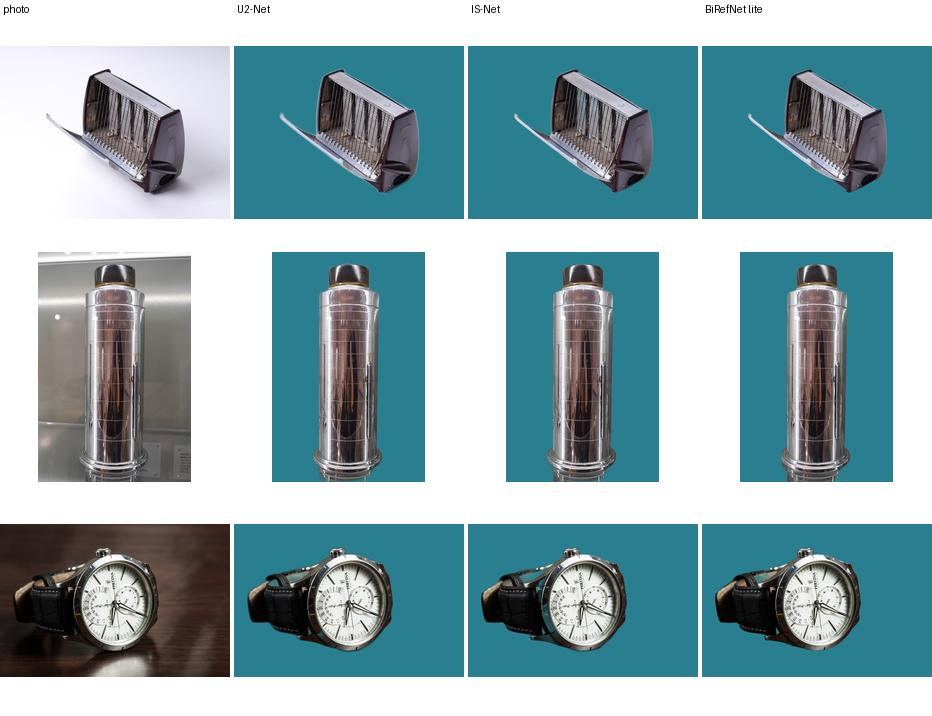
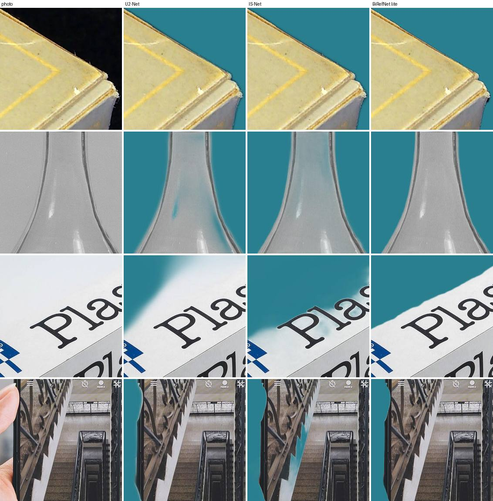
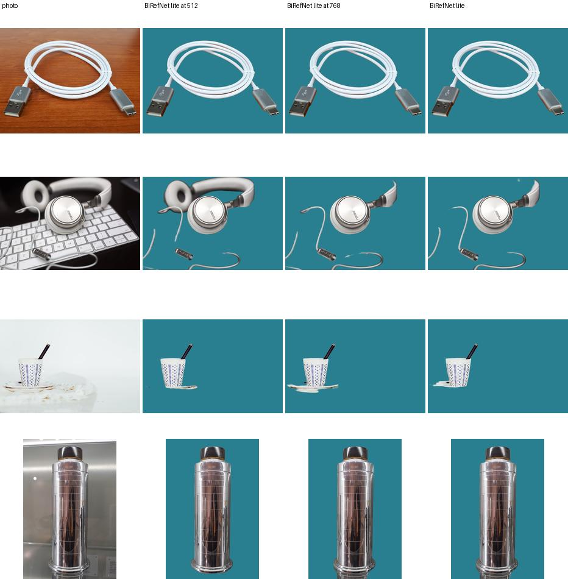
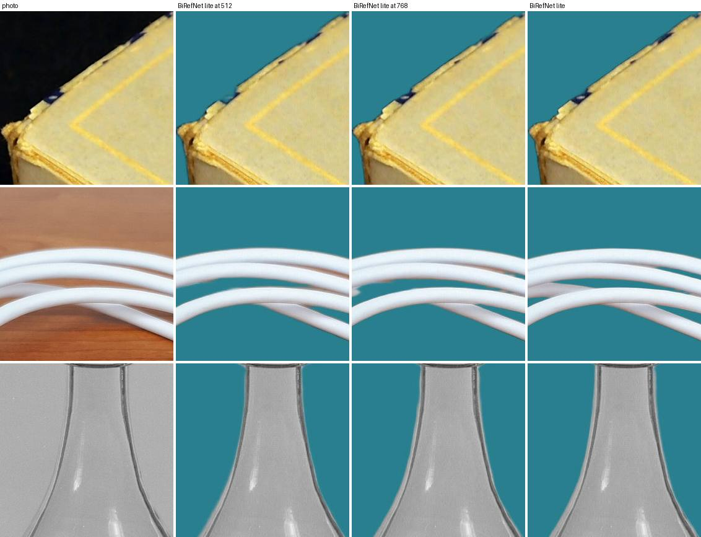

# Spike: cutting a product out of its photo on the computer (issue #277)

Date: 2026-11-25. Part of the [marketing videos spec](../spec/marketing-videos.md) ("Cutting a product out of its photo"). Builds on: [ADR-0024](../adr/0024-local-vision-models.md).

A product shot looks best when the product stands free of its photo's background. This spike checks whether Bardo can cut it out on the computer, free and offline, along ADR-0024's path (ONNX Runtime through `ort`, DirectML with the CPU fallback, no Python at run time): which model, how good on product photos, at what cost, and whether the mask can tell when it went wrong.

The spike ran in a 4-core Linux container with no graphics card (a 2.3 GHz Xeon with AVX-512), and on GitHub's `ubuntu-latest` and `windows-latest` runners (no graphics card) through the `cutout-spike` workflow, whose `convert.log` and JSON reports back the numbers below. Nothing here ran on a graphics card, and nothing ran on a person's own product photos: both are checks at the end, on #228. Memory is in MiB and GiB (2²⁰ and 2³⁰ bytes), as the probe reports it.

## Answers

| Question (#277) | Answer |
| --- | --- |
| Model | **BiRefNet lite, general use** (Swin-T backbone; MIT repository and model page), run at **768 × 768** in place of the 1024 × 1024 it is published at: the same grades on the test photos for 57 % of the time and about two thirds of the memory |
| Quality on product photos | On a plain or seamless background, as a photo made for a shop has: 11 of 15 cut with nothing to notice, 4 with a small defect (glass keeps what showed through it), none wrong. With a real scene behind the product: 3 with nothing to notice, 2 with a small defect and 5 wrong of 10, three of those five a product held in a hand |
| Does it run on ADR-0024's runtime? | Yes, after one rewrite at conversion: ONNX Runtime 1.24.2 has no kernel for the decoder's deformable convolution, so it is exported as GridSample and 1 × 1 convolutions, with the same output |
| File size | 94.7 MB with float16 weights (79.6 MB compressed) |
| Memory | For one photo in a job of its own, with ONNX Runtime's CPU memory arena off: 1.1 GiB in the container, 0.8 to 1.0 GiB on the runners. With the arena on, as `crates/vision` sets its sessions up today, 1.7 to 1.8 GiB, and 2.1 to 2.2 GiB over a session that cut the 25 photos |
| Time per photo, CPU | The model alone: 2.2 s in the container, 2.8 s and 2.4 s on the Linux and Windows runners, after 2 to 3 s to load it. Runners differ: an earlier, slower pair took 1.6 and 2.2 times the container's time at 1024 × 1024. Reading the photo and writing the cutout are not in these times |
| Time with DirectML | Not measurable without a graphics card: checks `S2.16` to `S2.18` on #228. On a runner with no graphics card DirectML fails to start and the probe falls back to the CPU, as ADR-0024 wants |
| Shipping | The manifest's form fits (entry below). The vision models' mirror does not: its files are all bundled in the installer. This one is better downloaded on first use from a mirror of its own, as ADR-0026 decides for LivePortrait |
| Does the mask tell a good cutout from a bad one? | Only the gross failures. A wrong cutout usually has a mask as sharp and sure as a right one. The user always sees the cutout and chooses; a guard on the mask pre-selects the card in the cases it can see |
| Build it? | Yes, **if check `S2.20` passes**: the 25 test photos are not a person's own product photos, and several kinds of product were not tried |

## What was built

No app code. `spikes/cutout-probe/` is a standalone crate with its own workspace and lock file, so the app's build and tests never compile it. It forbids `unsafe` and pins `ort` as ADR-0024 does.

| Piece | What it does |
| --- | --- |
| `cutout-probe info` | Loads every model on the CPU or DirectML, runs it once, and with `--placement` reads ONNX Runtime's profile to count the nodes each execution provider ran |
| `cutout-probe cut` | Cuts every photo with every model: writes the cutout (the photo's own pixels with an alpha) and the cutout over a flat backdrop, and reports the time of each step, the process's peak memory and what the mask says about itself (`src/stats.rs`). `--no-arena` turns the CPU's memory arena off |
| `models.toml` | Every source pinned (code by commit, weights by SHA-256 and by revision where the host has one), how each model wants its photo prepared, and the SHA-256 of every converted file |
| `tools/convert.py` | Downloads the sources, checks every hash, exports each model with `torch.onnx`, compares it with PyTorch on four of the test photos, keeps the weights as float16 (read back as float32) and compares again, and says whether each file is the one the manifest names |
| `photos/` | The 25 test photos and where each comes from |
| `grades.toml`, `tools/confidence.py` | The grade given by eye to each of the 175 cutouts, and how well the mask's numbers separate the bad ones |
| `tools/figures.py` | The figures below |

Run it: `python tools/convert.py models`, then from `spikes/cutout-probe`: `cargo run --release -- cut --models models --photos photos --out out --report out/cut.json`.

The probe reads a photo upright (EXIF orientation), stretches it to the model's square input as each upstream does, and stretches the mask back to the photo's size. The photo's pixels are never changed: the cutout is the photo plus an alpha.

## Test photos

Twenty-five photos from Wikimedia Commons, all CC0, committed at 1280 pixels on the longer side with their provenance in `spikes/cutout-probe/photos/README.md`. They cover the eight kinds #277 lists: an opaque box (2), a bottle with a label (3), glass and clear plastic (4), a reflective object (3), white on white (4), fine edges such as cables and straps (3), a product held in a hand (3), a plain background already (3).

The kinds overlap with what matters more, the background. Fifteen of the photos have a plain or seamless background (a museum's or a shop's photograph, whatever the product). Ten have a real scene behind the product: a table, a cloth, a shelf, a hand. `grades.toml` names the ten, and the results are given both ways.

What the set does not have: clothing (shoes and a backpack aside), food, jewellery, a set of three or more things, a product someone is wearing, a vertical photo from a phone, a photo in low light. None of the files carries an EXIF orientation, so the probe's upright reading is not exercised by the set. Check `S2.20` asks for these.

## Candidates

| Model | Input | Weights (SHA-256) | License of the repository | Converted file | SHA-256 of the converted file |
| --- | --- | --- | --- | --- | --- |
| [U²-Net](https://github.com/xuebinqin/U-2-Net), small (`u2netp.pth`) | 320 × 320 | `e7567cde…1b854` | Apache-2.0 | `u2netp_320x320.onnx`, 2.4 MB | `fbd20e30…7975` |
| U²-Net (`u2net.pth`) | 320 × 320 | `10025a17…cce58` | Apache-2.0 | `u2net_320x320.onnx`, 88.1 MB | `859b218d…bcc1` |
| [IS-Net](https://github.com/xuebinqin/DIS), general use (`isnet-general-use.pth`) | 1024 × 1024 | `9e1aafea…fac13` | Apache-2.0 ("our code and evaluation metric use Apache License 2.0") | `isnet_general_use_1024x1024.onnx`, 88.1 MB | `f4bf4442…5c74` |
| [BiRefNet lite](https://huggingface.co/ZhengPeng7/BiRefNet_lite), general use (revision `aa62cd8`) | 1024 × 1024 | `4417d897…d0815` | MIT (repository and model page) | `birefnet_lite_1024x1024.onnx`, 94.7 MB | `24b1439a…91a1` |
| The same weights | 768 × 768 | | | `birefnet_lite_768x768.onnx`, 94.7 MB | `5d589b5a…f0b0` |
| The same weights | 512 × 512 | | | `birefnet_lite_512x512.onnx`, 94.7 MB | `78ea5e98…d4b8c` |
| [BiRefNet lite, matting](https://huggingface.co/ZhengPeng7/BiRefNet_lite-matting) (revision `99c3341`) | 1024 × 1024 | `ce8bcfc0…97243` | MIT | `birefnet_lite_matting_1024x1024.onnx`, 94.7 MB | `ae0db212…7204` |

The full hashes, URLs and code commits are in `spikes/cutout-probe/models.toml`. RMBG is not a candidate: its weights are non-commercial.

**What each source states about its license, and what it was trained on.**

- **U²-Net.** The repository is Apache-2.0. The weight files are not in it: its README links to them on a file host. It was trained on DUTS-TR.
- **IS-Net.** The repository says its "code and evaluation metric use Apache License 2.0", and links to the weight files on a file host. Its README does not say what `isnet-general-use.pth` was trained on (it says so only for the academic `isnet.pth`: DIS5K). DIS5K's own terms allow the dataset for non-commercial research and education.
- **BiRefNet lite.** The repository is MIT, and the model page that holds the weight file states MIT for it. Its general-use weights were trained on DIS5K and on DUTS, HRSOD, UHRSD, HRS10K, P3M-10k and a set of human portraits, as the repository's table lists them. Of these sets' terms, only DIS5K's were read for this spike.

So BiRefNet lite's weight files (general use and matting) are the only ones here published with a license stated for them, and that license is MIT. Whether a dataset's terms reach weights trained on it is not a question a spike settles; the facts are here for whoever decides.

Of BiRefNet's other sizes, the lite model at 2K (1440 × 2560) was converted and dropped: 13 s a photo and 13.4 GB of memory on the CPU. The full model (Swin-L backbone) is not one of the small sizes #277 asks about and was not converted.

## Converting the models

`tools/convert.py` compares every exported file with PyTorch on four of the test photos (a camera, a drinking glass, a medicine bottle, a box), and stops when PyTorch's own mask finds nothing on them, so the comparison cannot pass on an empty mask. Every export matches PyTorch within 9·10⁻⁵ of the mask's range (0 to 1).

With float16 weights (read back as float32, as `crates/vision` ships its models), the largest of each over the four photos:

| File | Mean change of the mask | Largest change of one value |
| --- | --- | --- |
| U²-Net small | 1.2·10⁻³ | 0.134 |
| U²-Net | 1.7·10⁻⁴ | 0.030 |
| IS-Net | 6.7·10⁻⁵ | 0.002 |
| BiRefNet lite, 1024 | 1.1·10⁻⁵ | 0.037 |
| BiRefNet lite, 768 | 8.0·10⁻⁶ | 0.016 |
| BiRefNet lite, 512 | 1.0·10⁻⁵ | 0.008 |
| BiRefNet lite matting | 4.3·10⁻⁵ | 0.002 |

The largest change is that of a single value of the mask; the mean says the mask is the same. U²-Net's side outputs are dropped from its file and BiRefNet's sigmoid is put into its file, so every file gives one mask.

**The conversion does not write the same bytes on every machine.** The container's runs and the workflow's first run on `ubuntu-latest` gave the same SHA-256 for every file they both wrote; a later run of the workflow, on another runner, gave files of the same size and other hashes, and the run after it, on an Intel Xeon Platinum 8573C, the manifest's again. The exporter folds each batch norm into its convolution with the CPU's own arithmetic: exported in the container with PyTorch held to AVX2, U²-Net small has 25 folded weights that differ in their last bits (by about 10⁻⁷). Rounding to float16 usually hides that and sometimes does not. Such a file passes the same checks and gives the same masks to within the differences above; it is not the pinned file. So, as for ADR-0024's models, the mirrored file is the pin and not a new conversion, and `convert.py` says when what it wrote is not what the manifest names.

**One file per input size.** The export fixes the input's size, so 768 × 768 is a file of its own, 94.7 MB like the others. An export that takes any size was not tried.

### The deformable convolution

BiRefNet's decoder uses `torchvision.ops.deform_conv2d`. Neither PyTorch's exporter nor ADR-0024's runtime takes it as it is:

- `torch.onnx` has no export for it. The converter can write it as ONNX's own DeformConv (opset 19), with a symbolic function of its own.
- **ONNX Runtime 1.24.2, the version `ort` 2.0.0-rc.12 carries, has no CPU kernel for DeformConv** (the file fails to load: `NOT_IMPLEMENTED`). ONNX Runtime 1.25 and later load it.

So the converter rewrites the operator: for each tap of the kernel, `grid_sample` reads the input where that tap lands (bilinear, zeros outside), a 1 × 1 convolution applies that tap's weights, and the taps are summed. That exports as GridSample (in ONNX since opset 16, on a 4-D input; the files are opset 17) and Conv, which the pinned runtime has. The rewrite matches torchvision within 1.3·10⁻⁶ on random input, and upstream's own forward pass within 7·10⁻⁵ on the whole model on the four photos. `--deformconv` also writes the DeformConv file, for comparison.

The rewritten file has 26,429 nodes as saved, 300 of them GridSample; ONNX Runtime runs about 5,930 after its own optimization (IS-Net: 244), all on the CPU provider. On ONNX Runtime 1.32 (Python, the same container, at 1024 × 1024), the DeformConv file ran in 2.6 to 3.0 s and the rewritten one in 3.6 to 3.9 s: the rewrite costs about a third more time. It is the price of staying on ADR-0024's pin. Whether the DeformConv file is the better one once the pin moves, and whether DirectML takes it at all, would have to be measured then.

## Quality

Each of the 175 cutouts (25 photos, 7 files) was graded by eye over a flat backdrop, at the photo's size:

- **good**: nothing a viewer would notice;
- **usable**: the product is whole and reads as itself, with a defect seen on a close look (a soft or fringed edge, a small hole, a bit of the old background kept, clear glass still filled with it);
- **bad**: part of the product missing or see-through (the bite a finger leaves in its outline too), the wrong object, or background (a hand, a table) kept where anyone notices.

The grades are one viewer's, on 25 photos, given knowing which model made each cutout; `grades.toml` has each of them. They rank the models and say where each fails. They are not a rate to expect on other photos.

Every model at the size it is published at:

| Kind of photo | U²-Net small | U²-Net | IS-Net | BiRefNet lite | BiRefNet lite matting |
| --- | --- | --- | --- | --- | --- |
| Opaque box (2) | 1 usable, 1 bad | 2 usable | 2 good | 2 good | 2 bad |
| Bottle with a label (3) | 1 usable, 2 bad | 1 usable, 2 bad | 1 good, 2 bad | 2 good, 1 usable | 2 good, 1 bad |
| Glass, clear plastic (4) | 4 usable | 4 usable | 3 usable, 1 bad | 4 usable | 1 usable, 3 bad |
| Reflective (3) | 3 usable | 3 usable | 3 usable | 2 good, 1 usable | 2 good, 1 bad |
| White on white (4) | 2 usable, 2 bad | 3 usable, 1 bad | 1 good, 1 usable, 2 bad | 3 good, 1 bad | 1 good, 1 usable, 2 bad |
| Fine edges (3) | 1 usable, 2 bad | 3 bad | 2 good, 1 bad | 2 good, 1 bad | 1 good, 1 usable, 1 bad |
| Held in a hand (3) | 3 bad | 3 bad | 3 bad | 3 bad | 3 bad |
| Plain background (3) | 3 usable | 3 usable | 2 good, 1 usable | 3 good | 2 good, 1 bad |
| **All 25** | **15 usable, 10 bad** | **16 usable, 9 bad** | **8 good, 8 usable, 9 bad** | **14 good, 6 usable, 5 bad** | **8 good, 3 usable, 14 bad** |

The same grades by the photo's background (good, usable, bad):

| Background | U²-Net small | U²-Net | IS-Net | BiRefNet lite | BiRefNet lite matting |
| --- | --- | --- | --- | --- | --- |
| Plain or seamless (15) | 0, 10, 5 | 0, 11, 4 | 7, 4, 4 | **11, 4, 0** | 7, 1, 7 |
| A real scene (10) | 0, 5, 5 | 0, 5, 5 | 1, 4, 5 | **3, 2, 5** | 1, 2, 7 |

The figures show the photo, then U²-Net, IS-Net and BiRefNet lite (at 1024 × 1024) over the probe's backdrop.





Where each model fails:

- **U²-Net and its small model** compute a 320 × 320 mask. Stretched to the photo it gives every edge a blur several pixels wide that carries the old background with it, which is why neither has a single "good". The small model also takes a label for the product (the cigar box, two bottles). U²-Net keeps the table inside the loop of a cable and gets two of the three labelled bottles wrong.
- **IS-Net** has crisp edges and is right on boxes, cables, straps and most plain backgrounds. Its failure is the half-decided area: clear glass, the gaps of a toaster's rack and a patch of a phone's screen come out partly see-through, two of the three labelled bottles lose part of themselves, a white box fades into the white table.
- **BiRefNet lite** decides: its masks are nearly binary (at 768 × 768, 0.3 to 1.3 % of a photo is between 10 % and 90 %), so glass is cut whole and opaque and white on white holds. Its five failures all have a scene behind the product: a cup on a saucer on a white cloth (the saucer is torn in two), headphones lying on a keyboard (one ear cup, part of the band, pieces of cable), and the three products held in a hand (the fingers bite into the phone's and the bottle's outline; the hand comes along with the mug). The other five photos with a scene show a product alone on a table, a cloth or a shelf: 3 good, 2 usable. That reading was made after the grades, on five photos.
- **BiRefNet lite matting** is trained to give see-through alpha, and gives it to products: boxes are washed out, glass and chrome nearly vanish, hands stay. Not for this job.


Figure: the two models left out of the sheets above.



Figure: 280-pixel squares at the photo's own size, where IS-Net and BiRefNet lite differ most on four photos: the corner of a box, the neck of a glass bottle, the far end of a white box on white, a phone held in a hand.

What holds for every model:

- **A product held in a hand was cut whole by no model**, in any of the three photos. Either the fingers leave bites in its outline or the hand comes along. The card is the layout for these photos.
- **A product among other objects** (headphones lying on a keyboard, a cup on a saucer) is a guess at what the product is, and the guess is often wrong.
- **Glass keeps what showed through it.** The drinking glass photographed on a patterned cloth is cut correctly and still shows the cloth; a glass bottle from a grey studio stays grey. Glass and clear plastic want a plain, light background in the photo, and never grade better than usable here.
- **Shadows are dropped**, which is what a product shot with its own soft shadow wants. A reflection under the product on a glossy shelf is partly kept.
- **A product in two parts** (a lip balm beside its cap) is cut as two parts, correctly.
- **The old background's color stays in the edge pixels**, because the pixels are the photo's own. Over a backdrop of another color that is a line one or two pixels wide: clearest where the photo's background was dark (the first row of the edges figure), invisible where it was light. Shrinking the alpha by one pixel removed most of it on the three cutouts tried by hand, and by two pixels all of it. A shrink of a fixed width thins a cable or a strap and means less on a larger photo, so the slice has to scale it and look at thin things.

### The input's size

BiRefNet lite's weights were trained at 1024 × 1024. The same weights exported at 768 × 768 and 512 × 512 run faster in less memory (next section), so both were graded like the rest:

| | 512 × 512 | 768 × 768 | 1024 × 1024 |
| --- | --- | --- | --- |
| Good, usable, bad of 25 | 14, 6, 5 | 14, 6, 5 | 14, 6, 5 |
| Plain background (15) | 11, 4, 0 | 11, 4, 0 | 11, 4, 0 |
| A real scene (10) | 3, 2, 5 | 3, 2, 5 | 3, 2, 5 |
| Photos graded differently from 1024 | 2 | none | |
| Overlap of its mask with the 1024 mask, lowest photos | 0.54, 0.80, 0.95 | 0.74, 0.94, 0.98 | |

At 768 every photo has the grade it has at 1024. The two lowest overlaps (intersection over union) are the saucer and the headphones, photos all three sizes get wrong, each in its own way; on the other 23 the 768 mask overlaps the 1024 one by more than 0.97. At 512 the cable keeps more of the table between its loops (usable where the others are good) and the cocktail shaker loses the reflection under it (good where the others are usable).



Figure: the photos where the sizes differ most. On the headphones and the saucer each size fails differently; none is right.



Figure: 280-pixel squares at the photo's own size, where the 768 and 1024 masks differ most on three photos. Between the loops of the cable the 512 and 768 masks keep a little of the table where the 1024 one does not.

The test photos are 1280 pixels on the longer side, so a 768 mask is stretched 1.7 times and a 512 mask 2.5 times. One photo was also cut at 2144 × 1813 (with `--max-dim 4096`; the probe scales a photo down to 2048 unless told otherwise): the 768 mask, stretched 2.8 times, overlaps the 1024 one by 0.9986 and the edge is as clean; the 512 mask, stretched 4.2 times, is a little softer along the same edge. That is one photo, of a box.

## Cost on the machine

CPU only, the probe on ONNX Runtime 1.24.2, the 25 photos, one process per model. "Run" is the model alone: the median over the photos, with the fastest and the slowest. Preparing the input (a median of 34 ms at 768 × 768, 80 ms at 1024 × 1024) and writing the alpha back (about 30 ms) are beside it; reading the JPEG and writing the PNG are not timed.

In the container, three runs a photo (two for 768 and 512 with the arena off):

| Model | File | Load | Run | Peak memory, 25 photos | The same, arena off | Run, arena off |
| --- | --- | --- | --- | --- | --- | --- |
| U²-Net small | 2.4 MB | 0.1 s | 94 ms (90 to 116) | 445 MiB | | |
| U²-Net | 88.1 MB | 0.4 s | 216 ms (208 to 240) | 849 MiB | 649 MiB | 254 ms |
| IS-Net | 88.1 MB | 0.4 s | 573 ms (525 to 639) | 1,278 MiB | 856 MiB | 625 ms |
| BiRefNet lite, 512 | 94.7 MB | 2.7 s | 985 ms (915 to 1,124) | 1,103 MiB | 789 MiB | 1,084 ms |
| **BiRefNet lite, 768** | **94.7 MB** | **3.1 s** | **2,178 ms (2,043 to 2,500)** | **2,262 MiB** | **1,246 MiB** | **2,273 ms** |
| BiRefNet lite, 1024 | 94.7 MB | 3.0 s | 3,808 ms (3,708 to 4,011) | 3,346 MiB | 1,922 MiB | 4,134 ms |
| BiRefNet lite matting | 94.7 MB | 2.6 s | 3,887 ms (3,718 to 4,007) | 3,472 MiB | | |

On GitHub's runners, in a later run of the workflow (an AMD EPYC 9V74 under Linux, an AMD EPYC 9V45 under Windows), two runs a photo (one for the matting weights):

| Model | Run, `ubuntu-latest` | Peak memory | Run, `windows-latest` | Peak memory |
| --- | --- | --- | --- | --- |
| U²-Net small | 203 ms (201 to 234) | 444 MiB | 105 ms (95 to 125) | 439 MiB |
| U²-Net | 543 ms (539 to 566) | 836 MiB | 272 ms (248 to 301) | 678 MiB |
| IS-Net | 1,470 ms (1,464 to 1,503) | 1,318 MiB | 731 ms (692 to 817) | 1,153 MiB |
| BiRefNet lite, 512 | 1,366 ms (1,354 to 1,396) | 1,117 MiB | 1,071 ms (1,020 to 1,165) | 1,064 MiB |
| **BiRefNet lite, 768** | **2,828 ms (2,791 to 2,988)** | **2,255 MiB** | **2,364 ms (2,280 to 2,550)** | **2,145 MiB** |
| BiRefNet lite, 1024 | 5,139 ms (5,099 to 5,362) | 3,321 MiB | 4,562 ms (4,331 to 5,444) | 3,218 MiB |
| BiRefNet lite matting | 5,255 ms (5,205 to 5,454) | 3,431 MiB | 4,611 ms (4,374 to 5,402) | 3,327 MiB |

Runners are not one machine. The workflow's first run landed on a slower pair, whose CPUs it did not record: at three runs a photo, BiRefNet lite at 1024 × 1024 took 6.2 s under Linux and 8.6 s under Windows (1.6 and 2.2 times the container's time), and IS-Net 1.8 s and 2.1 s (3.1 and 3.7 times), with much the same peak memory. In the run of the table BiRefNet lite takes 1.1 to 1.4 times the container's time. The reference machine is a third kind of machine, which is what check `S2.18` is for.

**Memory is the cost to watch, and it depends on how the session is used.** ONNX Runtime's CPU memory arena keeps every block it once asked for, so a session that cuts photo after photo grows. For one photo in a process of its own, which is what a job that drops its session does (box-1, one run):

| BiRefNet lite at | Container, arena on | arena off | `ubuntu-latest`, arena on | arena off | `windows-latest`, arena on | arena off |
| --- | --- | --- | --- | --- | --- | --- |
| 512 × 512 | 801 MiB | 678 MiB | 783 MiB | 748 MiB | 737 MiB | 565 MiB |
| **768 × 768** | **1,806 MiB** | **1,089 MiB** | **1,789 MiB** | **1,007 MiB** | **1,726 MiB** | **867 MiB** |
| 1024 × 1024 | 2,161 MiB | 1,718 MiB | 2,139 MiB | 1,659 MiB | 2,033 MiB | 1,364 MiB |

- With the arena off (`--no-arena`; `ort`'s CPU provider `with_arena_allocator(false)`) the cutout is the same byte for byte and the run is slower: over the 25 photos in the container, 4 to 10 % for BiRefNet lite and IS-Net and 18 % for U²-Net; for the one photo of the table above, the first run of a session, 6 to 18 % on the runners.
- The memory is the process's whole peak while the model is loaded and running, sampled every 100 ms.
- **Time does not depend on the photo**: the input is always the model's size.
- **DirectML** could not be measured: the runners have no graphics card. There `--ep directml` fails to start ("No devices detected that match the filter criteria") and every one of the seven files runs on the CPU with the reason reported, which is the fallback ADR-0024 asks for. A cutout is made once per photo and kept, so a few seconds on the CPU are acceptable on their own; DirectML is worth using only if the checks show it faster with the same mask.
- The masks are the same everywhere: the statistics of every mask on the Windows runner, the Linux runner and the container agree within 10⁻⁴.

## The confidence signal

`cutout-probe` reports, for every mask: the share of the photo it covers (`area`), the share that is undecided, between 10 % and 90 % (`unsure`, and `unsure_to_area`), how much of the photo's outermost ring of pixels it covers (`border`), how many separate pieces it has (`pieces`, specks ignored) and the largest one's share, the mean alpha inside it (`body`), and the raw output's range. They are taken from the mask at the model's own size. `tools/confidence.py` sets them against the grades.

**One number alone does not separate bad from the rest.** Over all 175 cutouts the best is `unsure_to_area`: it ranks a bad cutout as the worse of a pair 82 times in 100, and `unsure` and `body` about 80. That is mostly the other models' half-decided masks. For BiRefNet lite at 768 alone, with five bad cutouts, `unsure_to_area`, `border` and `body` each manage about 75 in 100, and the others less.

**BiRefNet lite is sure when it is wrong.** Its five bad cutouts at 768:

| Photo | What went wrong | `area` | `unsure_to_area` | `border` | `pieces` |
| --- | --- | --- | --- | --- | --- |
| Cup on a saucer, white on white | saucer torn in two | 0.07 | 0.08 | 0.00 | 1 |
| Headphones on a keyboard | parts of the product | 0.16 | 0.08 | 0.02 | 5 |
| Phone held in a hand | fingers bite the outline | 0.23 | 0.01 | 0.00 | 1 |
| Mug held in a hand | the hand comes along | 0.45 | 0.02 | 0.14 | 1 |
| Bottle held in a hand | fingers bite the outline | 0.41 | 0.02 | 0.06 | 1 |

The saucer and the headphones have the two highest `unsure_to_area` of the 25, and the cable, graded good, is third at 0.05: the bad ones rank high, with no gap to draw a line in. The saucer also has the smallest `area` of the 25. The phone has the numbers of a good cutout.

**A guard, not a judge.** This rule refuses a cutout when the mask shows a gross failure:

- `area` under 0.02 (found next to nothing) or over 0.90 (took the photo);
- `border` over 0.05 (the object runs off the photo, or background came along);
- `unsure_to_area` over 0.25 (much of it undecided);
- three pieces or more (two is a product beside its lid; three may be a set, which the user can still choose).

| | Bad refused | Usable refused | Good refused |
| --- | --- | --- | --- |
| BiRefNet lite, 768 | 3 of 5 | 1 of 6 | 0 of 14 |
| BiRefNet lite, 1024 | 3 of 5 | 1 of 6 | 0 of 14 |
| BiRefNet lite, 512 | 3 of 5 | 0 of 6 | 0 of 14 |
| All seven files | 30 of 57 | 5 of 60 | 0 of 58 |

It never threw away a good cutout here, and it lets the saucer and the phone through. The usable one it refuses is the cocktail shaker, whose reflection on the shelf runs to the photo's edge: a refusal for the right reason. The thresholds were chosen on these same 25 photos and the margins are thin (the bottle in a hand is refused at a `border` of 0.06; a backpack graded good has 0.03), so the counts are the best case.

**A second opinion flags some of the rest, on thin margins.** Two were looked at, as overlap of masks (intersection over union):

- *IS-Net against BiRefNet lite at 1024.* The three lowest overlaps of the 25 are three of BiRefNet's five bad cutouts (0.61, 0.63, 0.83). The fourth lowest is a bottle BiRefNet cut well and IS-Net did not (0.88); the bottle in a hand is seventh (0.97) and the phone in a hand tenth (0.99). It would mean shipping and running a second model.
- *BiRefNet lite at 768 against itself at 1024.* The two lowest are the saucer and the headphones (0.74, 0.94); the three held in a hand are at 0.99. No second file's worth of signal.

Recorded, not proposed.

**So the user always chooses.** The mask cannot be trusted to pick the layout on its own. Bardo shows the cutout over the backdrop beside the card and the user picks; when the guard refuses a cutout the card is pre-selected and the reason is said.

## Shipping

- **The manifest's form fits.** A source pinned by revision and SHA-256, its code by commit, one `[[model]]` file: the entry below is in the form of `crates/vision/models.toml`. MIT is within that manifest's "Apache-2.0 or more permissive".
- **That manifest's mirror and bundle do not.** Every file in `crates/vision/models.toml` comes from one `vision-models-<n>` release, is fetched by `cargo xtask fetch-models` and goes into the installer. In the installer this file would add about 80 MB (94.7 MB compresses to 84 %) to the 0.2.0 installer's 282 MB, and every update would carry it, for something only ad projects with an opaque product photo ever use.
- **Downloaded on first use**, then, from a `cutout-models-<n>` release of Bardo's repository pinned by SHA-256, as ADR-0026 decides for LivePortrait and for the same reason. That takes a manifest (or a part of one) whose files are not bundled, and a downloader. ADR-0026 describes the downloader and no crate has it yet; whichever slice comes first builds it.
- **The mirrored file is the pin**, as for the other models: a new conversion on another machine need not write the same bytes.

Draft entry, in the manifest's form:

```toml
[sources.birefnet_lite]
# Salient-object segmentation, Swin-T backbone, trained at 1024×1024;
# general use.
name = "BiRefNet lite"
version = "aa62cd8"
url = "https://huggingface.co/ZhengPeng7/BiRefNet_lite/resolve/aa62cd87eafb9cc43056d08ef3615a14628b831d/model.safetensors"
sha256 = "4417d89795250e698c3cb0ae8df15743810065f646f48a694fdfa7ca052d0815"
license = "MIT"
license_url = "https://huggingface.co/ZhengPeng7/BiRefNet_lite"

[sources.birefnet_lite.code]
repo = "https://github.com/ZhengPeng7/BiRefNet.git"
commit = "f7079632d681ecf12161fcea8905682934e59e51"
license = "MIT"

[[model]]
# Exported at 768×768. Deformable convolutions rewritten as GridSample and
# Conv; sigmoid inside.
file = "birefnet_lite_768x768.onnx"
from = "birefnet_lite"
sha256 = "5d589b5abc03530addf90037759bbc78b3c0b888c909589ae94ce24a7593f0b0"
size = 94670931
```

The photo goes in as RGB divided by 255, less the mean (0.485, 0.456, 0.406), over the deviation (0.229, 0.224, 0.225), stretched to 768 × 768; the output is the alpha, 0 to 1, with no further scaling.

## What the slice needs

- **In `crates/vision`**, on ADR-0024's runtime, as a local job off the UI thread: load and run for the first photo, the run alone for each one after, with the session dropped when the job ends. The CPU's memory arena off for this model. Not at the same time as take analysis or a local take.
- **A look at free memory before the job**, as `crates/vision` already does before Video Depth Anything: where the model's peak is not free, the photo stays a card and the user is told why.
- **The photo read upright** (EXIF orientation, which the test photos did not exercise) and limited to 2048 pixels on the longer side before it is cut.
- **The cutout is a picture with transparency kept beside the photo**: the photo's own pixels, the mask as alpha. From there #285's cutout layout takes it as it takes any photo with transparency, and the spec's rule that the product is only scaled, never redrawn, holds. Scaling must work on premultiplied alpha, or the edge darkens.
- **The edge.** Shrink the alpha before saving, to drop the line of old background: by a width that follows the photo's size, checked on a cable and a strap.
- **A product, or its reflection, that runs to the photo's edge** is refused by the guard. The slice decides whether the user may still take such a cutout, flat against the frame's edge.
- **The choice is the user's**: cutout or card, seen over the backdrop, with the guard pre-selecting the card. A cutout is never used without having been seen.
- **The guide says which photos work**: the product alone and whole inside the photo, on a plain surface or against a wall; glass against a plain light one; not held in a hand, not among other things.

## What was not tried

- The kinds of product listed under "Test photos", and a person's own photos (`S2.20`).
- Fixing a mask by hand (a brush, a click on the part to keep). The answer to a wrong cutout here is the card.
- Weights quantized to 8 bits, which would about halve the file again, and a single export for every input size.
- A photo that already has transparency needs none of this: the spec takes it as cut out already.
- A graphics card (`S2.16` to `S2.19`).

## Decisions

1. **Build the cutout with BiRefNet lite (general use) at 768 × 768**, float16 weights, its deformable convolutions rewritten at conversion, **once check `S2.20` passes**: of ten of the user's own photos of a product alone (on a table, on a shelf or against a wall; nothing else in the picture, not held), at least eight fit for an ad. If it fails, the card stays the only layout for opaque photos and the cutout is not built.
2. **The card stays**, as the fallback and as the layout for photos the cutout does not suit.
3. **Never chosen silently.** The user sees the cutout and picks; the guard above pre-selects the card for the failures a mask can show.
4. **Downloaded on first use**, not in the installer.
5. **On the CPU, arena off, until the checks on #228 say otherwise**: DirectML only if it is faster on the reference machine and gives the same cutout.
6. **If memory proves too much on real machines, the 512 × 512 export comes before IS-Net**: the same grades but for two photos, half the time, 0.7 GiB. On the one larger photo tried its edge came out a little softer.
7. **Not built: the matting weights, U²-Net, IS-Net, a second model as a second opinion, a paid background remover.**

## Windows-only checks (for #228)

The probe runs outside Bardo, from the `cutout-probe-windows-kit` artifact of the `cutout-spike` workflow (the executable, `DirectML.dll`, the seven converted models and the test photos, about 515 MB zipped). A fresh kit: Actions › Cutout spike › Run workflow. The checks are on #228 with checkboxes, `S2.16` to `S2.20`.

1. Download the kit from the workflow run, unzip it to `C:\cutout-kit` and open PowerShell there.
2. **DirectML starts (`S2.16`).** `.\cutout-probe.exe info --models models --ep directml --placement --out info-directml.json`. Each line should read `on DirectMl`, not `on Cpu (DirectML failed: …)`. The JSON's `on_cpu` names the operators DirectML left to the CPU.
3. **Speed on the graphics card (`S2.17`).** `.\cutout-probe.exe cut --models models --photos photos --model birefnet_lite_768x768 --ep directml --out dml --report cut-directml.json`, with the highest Dedicated GPU memory in Task Manager › Performance › GPU while it runs.
4. **Speed and memory on the CPU of the same machine (`S2.18`).** The same with `--ep cpu --no-arena --out cpu --report cut-cpu.json`, then once more with `--model birefnet_lite_512x512` and `--report cut-cpu-512.json`.
5. **The same picture (`S2.19`).** `dml\box-1.birefnet_lite_768x768.jpg` beside `cpu\box-1.birefnet_lite_768x768.jpg`, and the same for `glass-4` and `fine-1`: no difference to the eye.
6. **Product photos of your own (`S2.20`).** Ten photos of a product alone, as a phone takes them: on a table, on a shelf or against a wall, nothing else in the picture, not held; at least three of them vertical. Among them, where you have such products: one of glass or metal, one white thing on a light surface, one piece of clothing, one of food and one small thing such as a ring. Then, in file names that sort after those ten, a few of anything else an ad of yours would show: a set of three things, a photo in low light. In a folder `mine`: `.\cutout-probe.exe cut --models models --photos mine --model birefnet_lite_768x768 --no-arena --out mine-out --report mine.json`. For each `mine-out\*.jpg`: fit for an ad or not, and what is wrong. The check passes when at least eight of the ten are fit. The photos stay on the computer; `mine.json` has each file's name and size, the times and the masks' numbers, and no picture.
