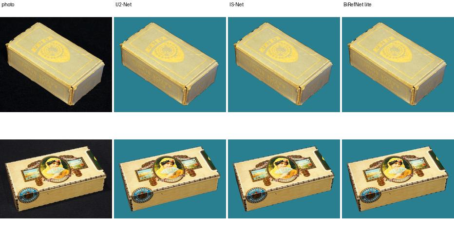
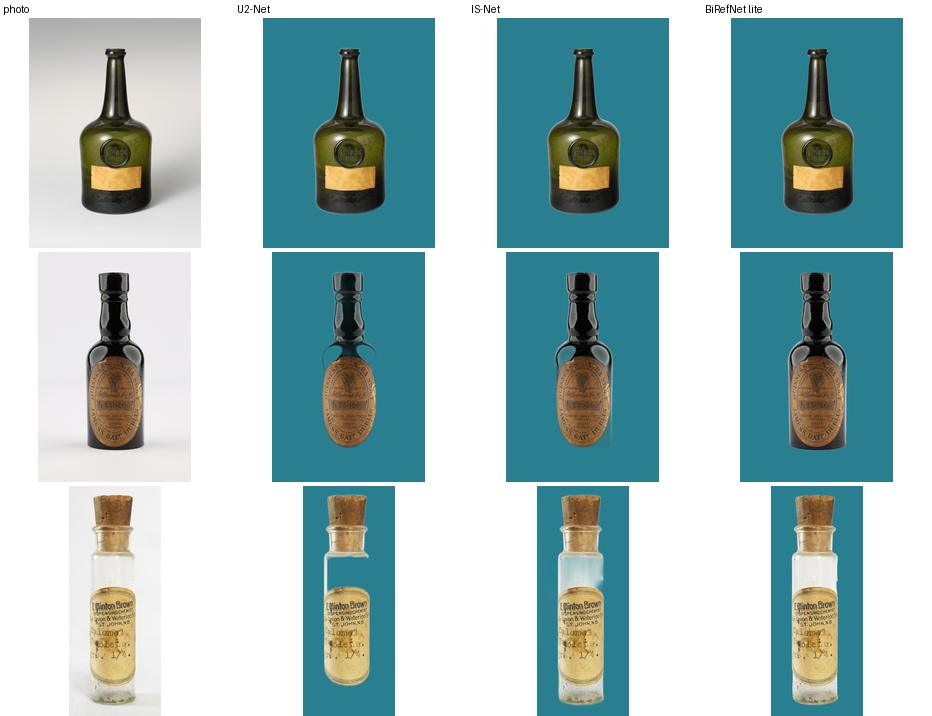
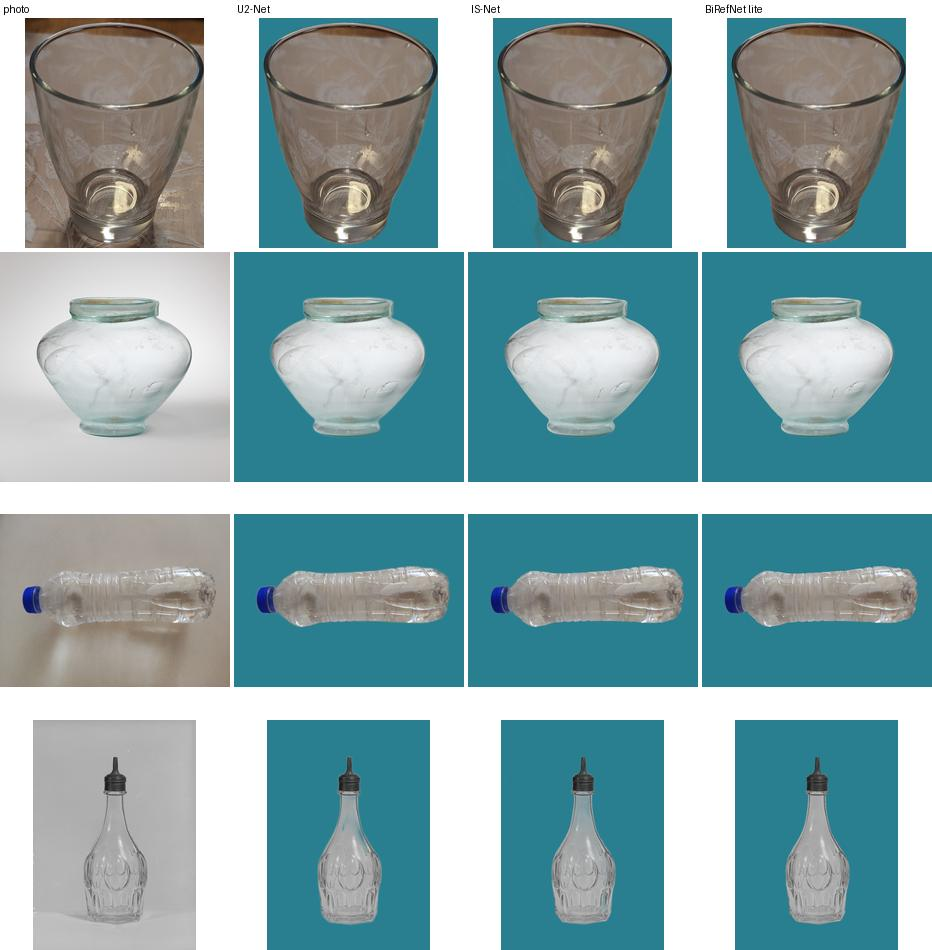
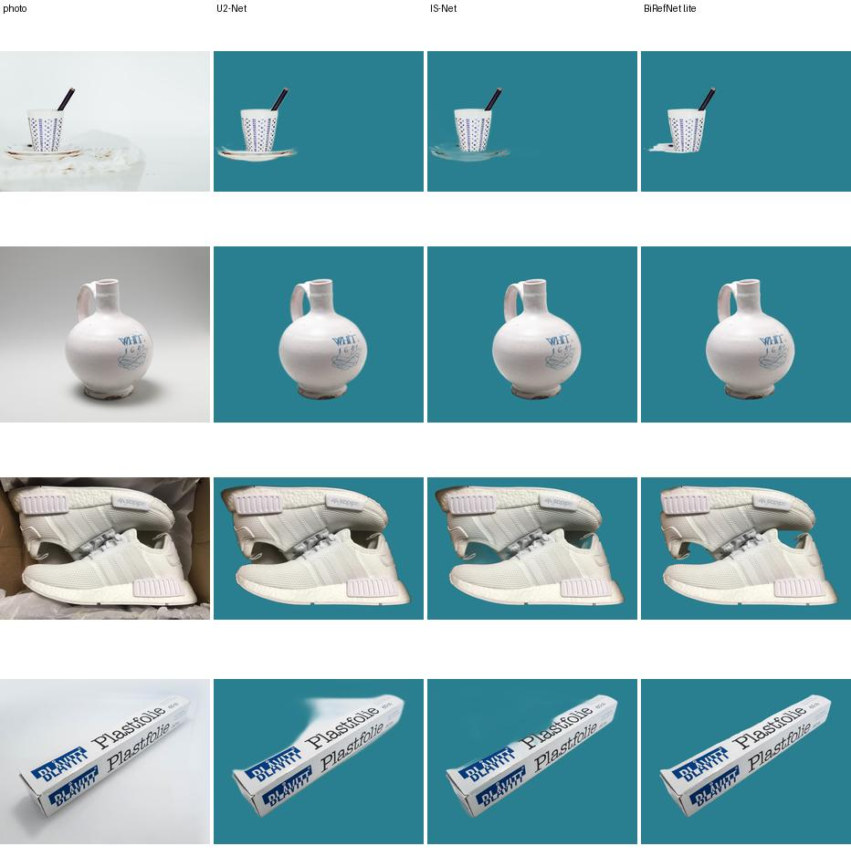
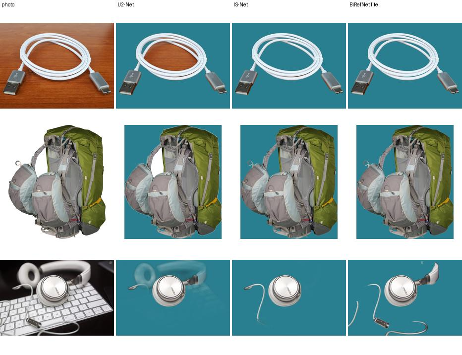
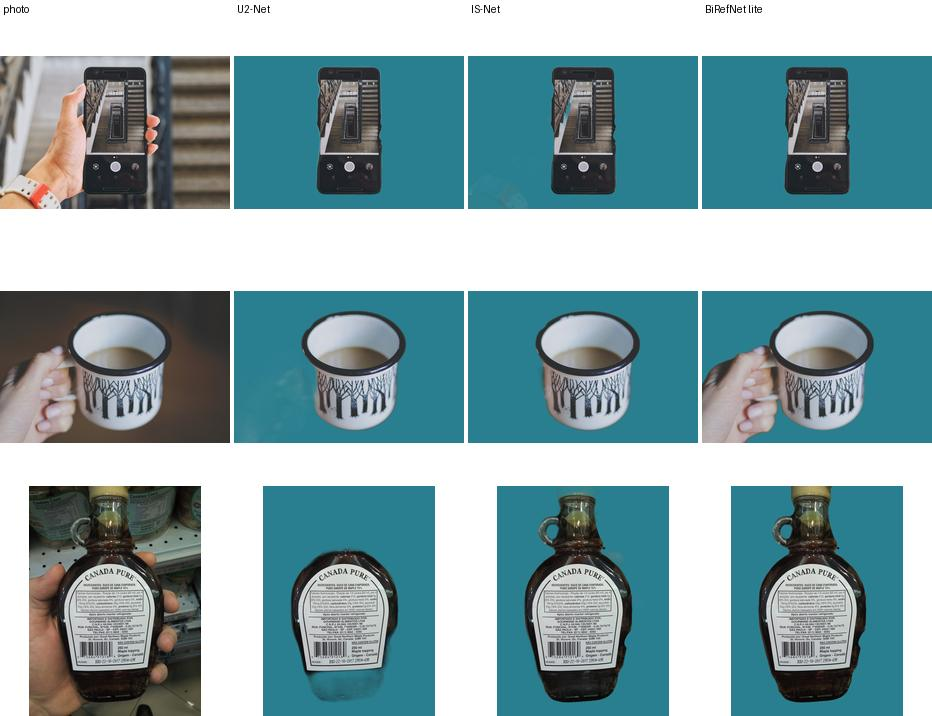
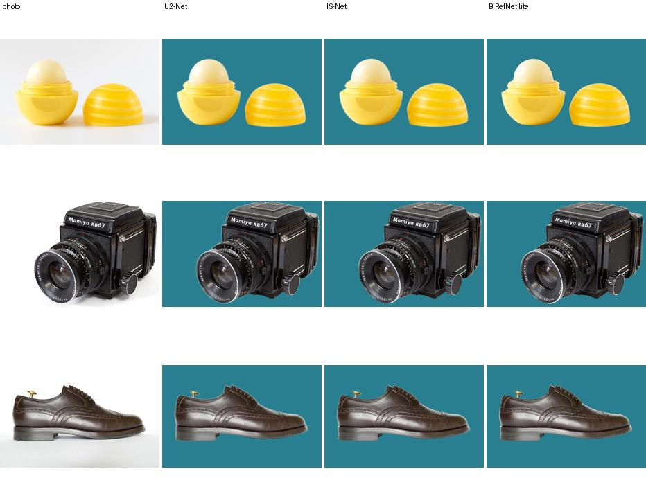
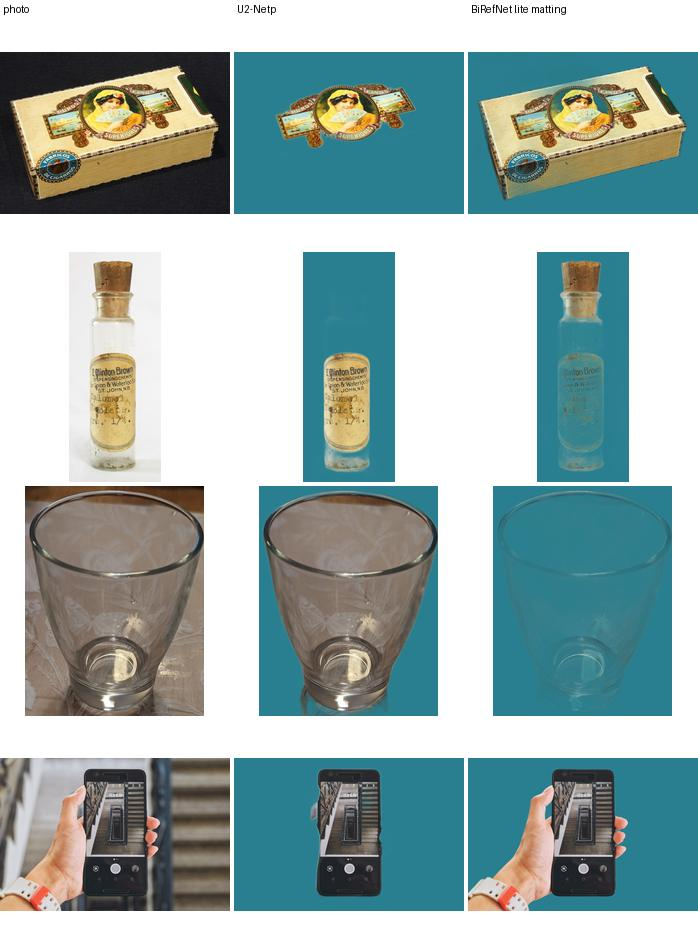

# Spike: cutting a product out of its photo on the computer (issue #277)

Date: 2026-11-25. Part of the [marketing videos spec](../spec/marketing-videos.md) ("Cutting a product out of its photo"). Builds on: [ADR-0024](../adr/0024-local-vision-models.md).

A product shot looks best when the product stands free of its photo's background. This spike checks whether Bardo can cut it out on the computer, free and offline, along ADR-0024's path (ONNX Runtime through `ort`, DirectML with the CPU fallback, no Python at run time): which model, how good on product photos, at what cost, and whether the mask can tell when it went wrong.

The spike ran in a 4-core Linux container with no graphics card, and on GitHub's `ubuntu-latest` and `windows-latest` runners (4 vCPU, no graphics card) through the `cutout-spike` workflow. Nothing here ran on a graphics card: the reference machine is measured with the checks at the end, on #228. Times move by about ±10 % from run to run.

## Answers

| Question (#277) | Answer |
| --- | --- |
| Model | **BiRefNet lite, general use** (Swin-T backbone, 1024 × 1024, MIT code and weights). 17 of 25 test photos cut with nothing to notice, 5 with a small defect, 3 wrong. IS-Net is six times faster and second (11, 6, 8); U²-Net's masks are too soft; BiRefNet's matting weights treat products as see-through |
| Does it run on ADR-0024's runtime? | Yes, after one rewrite at conversion: ONNX Runtime 1.24.2 has no kernel for the decoder's deformable convolution, so it is exported as GridSample and a 1 × 1 convolution, with the same output |
| Quality on product photos | Good on boxes, labelled bottles, reflective objects, white on white, cables and straps, plain backgrounds. Glass is cut whole and opaque, so it keeps whatever showed through it. A product held in a hand and a product among other objects fail |
| File size | 94.7 MB with float16 weights (80 MB compressed) |
| Memory | 3.3 GB at the peak as ADR-0024's sessions are set up today; 1.9 GB with ONNX Runtime's CPU memory arena off, for 9 % more time |
| Time per photo, 4-core CPU | 3.8 s for the model, 3.9 s with reading and writing, after 3 s to load it |
| Time with DirectML | Not measurable without a graphics card: checks `S2.16` to `S2.18` on #228. The CPU's 4 s is already enough for a job that runs once per photo |
| Shipping | Fits the vision-models manifest as it is (entry below). In the installer it would add 80 MB to 282 MB; better downloaded on first use, as ADR-0026 does for LivePortrait |
| Does the mask tell a good cutout from a bad one? | Only the gross failures. A wrong cutout usually has a mask as sharp and sure as a right one. The user always sees the cutout and chooses; a guard on the mask pre-selects the card in the cases it can see |

## What was built

No app code. `spikes/cutout-probe/` is a standalone crate with its own workspace and lock file, so the app's build and tests never compile it. It forbids `unsafe` and pins `ort` as ADR-0024 does.

| Piece | What it does |
| --- | --- |
| `cutout-probe info` | Loads every model on the CPU or DirectML, runs it once, and with `--placement` reads ONNX Runtime's profile to count the nodes each execution provider ran |
| `cutout-probe cut` | Cuts every photo with every model: writes the cutout (the photo's own pixels with an alpha) and the cutout over a flat backdrop, and reports the time of each step, the process's peak memory and what the mask says about itself (`src/stats.rs`). `--no-arena` turns the CPU's memory arena off |
| `models.toml` | Every source pinned (code by commit, weights by SHA-256 and by revision where the host has one), and how each model wants its photo prepared |
| `tools/convert.py` | Downloads the sources, checks every hash, exports each model with `torch.onnx`, checks it against PyTorch, then keeps the weights as float16 (read back as float32) and checks again on a test photo |
| `photos/` | The 25 test photos and where each comes from |
| `grades.toml`, `tools/confidence.py` | The grade given by eye to each of the 125 cutouts, and how well the mask's numbers separate the bad ones |
| `tools/figures.py` | The figures below |

Run it: `python tools/convert.py models`, then from `spikes/cutout-probe`: `cargo run --release -- cut --models models --photos photos --out out --report out/cut.json`.

The probe reads a photo upright (EXIF orientation), stretches it to the model's square input as each upstream does, and stretches the mask back to the photo's size. The photo's pixels are never changed: the cutout is the photo plus an alpha.

## Test photos

Twenty-five photos from Wikimedia Commons, all CC0, committed at 1280 pixels on the longer side with their provenance in `spikes/cutout-probe/photos/README.md`. They cover the eight kinds #277 lists: an opaque box (2), a bottle with a label (3), glass and clear plastic (4), a reflective object (3), white on white (4), fine edges such as cables and straps (3), a product held in a hand (3), a plain background already (3). Museum photographs stand beside phone snapshots on a table.

## Candidates

| Model | Input | Weights (SHA-256) | License, as the source states it | Converted file | SHA-256 of the converted file |
| --- | --- | --- | --- | --- | --- |
| [U²-Net](https://github.com/xuebinqin/U-2-Net), small (`u2netp.pth`) | 320 × 320 | `e7567cde…1b854` | Apache-2.0 (repository, which distributes the weights) | `u2netp_320x320.onnx`, 2.4 MB | `fbd20e30…7975` |
| U²-Net (`u2net.pth`) | 320 × 320 | `10025a17…cce58` | Apache-2.0 | `u2net_320x320.onnx`, 88.1 MB | `859b218d…bcc1` |
| [IS-Net](https://github.com/xuebinqin/DIS), general use (`isnet-general-use.pth`) | 1024 × 1024 | `9e1aafea…fac13` | Apache-2.0 ("our code and evaluation metric use Apache License 2.0") | `isnet_general_use_1024x1024.onnx`, 88.1 MB | `f4bf4442…5c74` |
| [BiRefNet lite](https://huggingface.co/ZhengPeng7/BiRefNet_lite), general use (revision `aa62cd8`) | 1024 × 1024 | `4417d897…d0815` | MIT (repository and model page) | `birefnet_lite_1024x1024.onnx`, 94.7 MB | `24b1439a…91a1` |
| [BiRefNet lite, matting](https://huggingface.co/ZhengPeng7/BiRefNet_lite-matting) (revision `99c3341`) | 1024 × 1024 | `ce8bcfc0…97243` | MIT | `birefnet_lite_matting_1024x1024.onnx`, 94.7 MB | `ae0db212…7204` |

The full hashes, URLs and code commits are in `spikes/cutout-probe/models.toml`. RMBG is not a candidate: its weights are non-commercial.

**Licenses and training data.** The licenses above are those of the code and of the weight files as their authors publish them. IS-Net and BiRefNet's general-use weights were trained on DIS5K (BiRefNet on other sets too), and DIS5K's own terms of use allow the *dataset* for non-commercial research and education only. U²-Net was trained on DUTS. The authors publish the trained weights under Apache-2.0 and MIT all the same. This is recorded as a fact to weigh, not as a finding against a model; of the three, only U²-Net's weights do not come from DIS5K, and its cutouts are not good enough (below).

Of BiRefNet's other sizes, the lite model at 2K (1440 × 2560) was converted and dropped: 13 s a photo and 13.4 GB of memory on the CPU. The full model (Swin-L backbone) is not one of the small sizes #277 asks about and was not converted.

## Converting the models

Every export matches PyTorch within 2·10⁻⁵ of the mask's range (0 to 1). With float16 weights (read back as float32, as `crates/vision` ships its models), the mask of a test photo moves by 4·10⁻⁴ on average at most (U²-Net small) and 4·10⁻⁶ for BiRefNet lite and IS-Net; the largest single value moves by 0.06 for U²-Net small, 0.005 for BiRefNet lite (`convert.log`). U²-Net's side outputs are dropped from its file and BiRefNet's sigmoid is put into its file, so every file gives one mask.

### The deformable convolution

BiRefNet's decoder uses `torchvision.ops.deform_conv2d`. Neither PyTorch's exporter nor ADR-0024's runtime takes it as it is:

- `torch.onnx` has no export for it. The converter can write it as ONNX's own DeformConv (opset 19), with a symbolic function of its own.
- **ONNX Runtime 1.24.2, the version `ort` 2.0.0-rc.12 carries, has no CPU kernel for DeformConv** (the file fails to load: `NOT_IMPLEMENTED`). ONNX Runtime 1.25 and later load it.

So the converter rewrites the operator: for each tap of the kernel, `grid_sample` reads the input where that tap lands (bilinear, zeros outside), and one 1 × 1 convolution over the taps applies the weights. That exports as GridSample (opset 16, 4-D input) and Conv, which the pinned runtime has. The rewrite matches torchvision within 1.3·10⁻⁶ on random input and upstream's own forward pass within 2·10⁻⁵ on the whole model. `--deformconv` also writes the DeformConv file, for comparison.

On ONNX Runtime 1.32 (Python, the same container), the DeformConv file ran in 2.6 to 3.0 s and the rewritten one in 3.6 to 3.9 s: the rewrite costs about a third more time. It is the price of staying on ADR-0024's pin, and the file to ship until the pin moves.

## Quality

Each of the 125 cutouts (25 photos, 5 models) was graded by eye over a flat backdrop, at the photo's size:

- **good**: nothing a viewer would notice;
- **usable**: the product is whole and reads as itself, with a defect seen on a close look (a soft or fringed edge, a small bite or hole, a bit of the old background kept);
- **bad**: part of the product missing or see-through, the wrong object, or background (a hand, a table) kept where anyone notices.

The grades are one viewer's, on 25 photos; `grades.toml` has each of them.

| Kind of photo | U²-Net small | U²-Net | IS-Net | BiRefNet lite | BiRefNet lite matting |
| --- | --- | --- | --- | --- | --- |
| Opaque box (2) | 1 usable, 1 bad | 2 usable | 2 good | 2 good | 2 bad |
| Bottle with a label (3) | 1 usable, 2 bad | 1 usable, 2 bad | 1 good, 2 bad | 2 good, 1 usable | 2 good, 1 bad |
| Glass, clear plastic (4) | 4 usable | 4 usable | 2 good, 2 usable | 3 good, 1 usable | 1 good, 3 bad |
| Reflective (3) | 3 usable | 3 usable | 1 good, 2 usable | 2 good, 1 usable | 2 good, 1 bad |
| White on white (4) | 2 usable, 2 bad | 3 usable, 1 bad | 1 good, 1 usable, 2 bad | 3 good, 1 bad | 1 good, 1 usable, 2 bad |
| Fine edges (3) | 1 usable, 2 bad | 3 bad | 2 good, 1 bad | 2 good, 1 bad | 1 good, 1 usable, 1 bad |
| Held in a hand (3) | 3 bad | 1 usable, 2 bad | 3 bad | 2 usable, 1 bad | 3 bad |
| Plain background (3) | 3 usable | 3 usable | 2 good, 1 usable | 3 good | 2 good, 1 bad |
| **All 25** | **15 usable, 10 bad** | **17 usable, 8 bad** | **11 good, 6 usable, 8 bad** | **17 good, 5 usable, 3 bad** | **9 good, 2 usable, 14 bad** |

The figures show the photo, then U²-Net, IS-Net and BiRefNet lite over the probe's backdrop.
















Where each model fails:

- **U²-Net and its small model** compute a 320 × 320 mask. Stretched to the photo it gives every edge a blur several pixels wide that carries the old background with it, which is why neither has a single "good". The small model also takes a label for the product (the cigar box, two bottles). U²-Net keeps the table inside the loop of a cable and loses clear glass.
- **IS-Net** has crisp edges and is right on boxes, opaque bottles, cables, straps and plain backgrounds. Its failure is the half-decided area: clear glass (the medicine bottle, the sauce bottle), the gaps of a toaster's rack and a patch of a phone's screen come out partly see-through, a dark bottle loses its lower side, a white box fades into the white table.
- **BiRefNet lite** decides: its masks are nearly binary (0.2 to 1 % of a photo is between 10 % and 90 %), so glass is cut whole and opaque and white on white holds. Its three failures are a cup on a saucer on a white cloth (the saucer is torn in two), headphones on a keyboard (one ear cup, part of the band, pieces of cable) and a mug held by its handle (the hand comes along, cut by the photo's edge).
- **BiRefNet lite matting** is trained to give see-through alpha, and gives it to products: boxes are washed out, glass and chrome nearly vanish, hands stay. Not for this job.



Figure: the two models left out of the sheets above.


Figure: 280-pixel squares at the photo's own size, where IS-Net and BiRefNet lite differ most on four photos: the corner of a box, the neck of a glass bottle, the far end of a white box on white, a phone held in a hand.

What holds for every model:

- **A product held in a hand cannot be cut whole.** Either the fingers leave bites in its outline or the hand comes along. The card is the layout for these photos.
- **A product among other objects** (headphones lying on a keyboard, a cup on a saucer) is a guess at what the product is, and the guess is often wrong.
- **Glass keeps what showed through it.** The drinking glass photographed on a patterned cloth is cut correctly and still shows the cloth. Glass and clear plastic want a plain, light background in the photo.
- **Shadows are dropped**, which is what a product shot with its own soft shadow wants. A reflection under the product on a glossy shelf is partly kept.
- **A product in two parts** (a jar beside its lid, a pair of shoes) is cut as two parts, correctly.
- **A photo larger than the model's input** still gets a clean edge: the one photo tried at 2144 × 1813, whose mask is stretched 2.1 times, was cut as cleanly as its 1280-pixel copy.
- **The old background's color stays in the edge pixels**, because the pixels are the photo's own. Over a backdrop of another color that is a line one or two pixels wide: clearest where the photo's background was dark (the first row of the edges figure), invisible where it was light. Shrinking the alpha by one pixel removed most of it on the three cutouts tried by hand, and by two pixels all of it.

## Cost on the machine

CPU only, the probe on ONNX Runtime 1.24.2, 25 photos of 1280 pixels, three runs each, one process per model. "Run" is the model alone (median, with the fastest and slowest photo); preparing the input takes 80 ms for a 1024 × 1024 model and writing the alpha back 30 ms.

| Model | File | Load | Run, container (4 cores) | Peak memory | Peak memory, arena off | Run, arena off |
| --- | --- | --- | --- | --- | --- | --- |
| U²-Net small | 2.4 MB | 0.1 s | 94 ms (90 to 116) | 445 MB | | |
| U²-Net | 88.1 MB | 0.4 s | 216 ms (208 to 240) | 849 MB | 649 MB | 254 ms |
| IS-Net | 88.1 MB | 0.4 s | 573 ms (525 to 639) | 1,278 MB | 856 MB | 625 ms |
| **BiRefNet lite** | **94.7 MB** | **3.0 s** | **3,808 ms (3,708 to 4,011)** | **3,346 MB** | **1,922 MB** | **4,134 ms** |
| BiRefNet lite matting | 94.7 MB | 2.6 s | 3,887 ms (3,718 to 4,007) | 3,472 MB | | |

- **Memory is the cost to watch.** ONNX Runtime's CPU memory arena keeps every block it once asked for; with it off (`--no-arena`; `ort`'s CPU provider `with_arena_allocator(false)`), BiRefNet lite peaks at 1.9 GB instead of 3.3 GB, for 9 % more time and the same cutout byte for byte. The memory is the process's whole peak while the model is loaded and running.
- **Time does not depend on the photo**: the input is always 1024 × 1024.
- BiRefNet lite's file is 5,931 nodes against IS-Net's 244; all of them ran on the CPU provider. Which of them DirectML takes is check `S2.16`.
- **DirectML** could not be measured: the runners have no graphics card. A cutout is made once per photo and kept, so the CPU's 4 s is acceptable on its own; DirectML is worth using only if the checks show it faster with the same mask.

## The confidence signal

`cutout-probe` reports, for every mask: the share of the photo it covers (`area`), the share that is undecided, between 10 % and 90 % (`unsure`, and `unsure_to_area`), how much of the photo's border it touches (`border`), how many separate pieces it has (`pieces`, specks ignored) and the largest one's share, the mean alpha inside it (`body`), and the raw output's range. They are taken from the mask at the model's own size. `tools/confidence.py` sets them against the grades.

**One number alone does not separate bad from the rest.** Over all 125 cutouts the best are the three that measure indecision, `unsure_to_area`, `unsure` and `body`: each ranks a bad cutout as the worse of a pair about 85 times in 100. `area`, `border` and the pieces are near chance on their own.

**BiRefNet lite is sure when it is wrong.** Its three bad cutouts:

| Photo | What went wrong | `area` | `unsure_to_area` | `border` | `pieces` |
| --- | --- | --- | --- | --- | --- |
| Cup on a saucer, white on white | saucer torn in two | 0.06 | 0.04 | 0.00 | 1 |
| Headphones on a keyboard | parts of the product | 0.16 | 0.06 | 0.01 | 4 |
| Mug held in a hand | the hand comes along | 0.45 | 0.02 | 0.14 | 1 |

The first has the numbers of a good cutout (the cable, graded good, has 0.20, 0.05, 0.00, 1). The other two can be caught by what a product shot needs anyway: one object, whole inside the photo.

**A guard, not a judge.** This rule refuses a cutout when the mask shows a gross failure:

- `area` under 0.02 (found next to nothing) or over 0.90 (took the photo);
- `border` over 0.10 (the object runs off the photo, or background came along);
- `unsure_to_area` over 0.25 (much of it undecided);
- three pieces or more (two is a jar beside its lid).

On BiRefNet lite it refuses 2 of the 3 bad cutouts and none of the other 22. Over all five models it refuses 21 of 43 bad cutouts, 1 of 45 usable and none of 37 good: it never threw away a good cutout here, and it lets half of the bad ones through. The thresholds were chosen on these same 25 photos, so the counts are the best case.

**A second opinion separates better, at a price.** Where BiRefNet lite's and IS-Net's masks overlap least (intersection over union), BiRefNet lite is wrong: its three bad cutouts are the three lowest of the 25 (0.61, 0.63, 0.83), and the next is at 0.88, a bottle BiRefNet lite cut well and IS-Net did not. That would mean shipping and running a second model (88 MB, 0.6 s) for a hint whose margin on 25 photos is thin. Recorded, not proposed.

**So the user always chooses.** The mask cannot be trusted to pick the layout on its own. Bardo shows the cutout over the backdrop beside the card and the user picks; when the guard refuses a cutout the card is pre-selected and the reason is said.

## Shipping

- **The manifest.** The model fits `crates/vision/models.toml` as it is: a source pinned by revision and SHA-256, its code by commit, one `[[model]]` file. MIT is within the manifest's "Apache-2.0 or more permissive".
- **In the installer** the file would add about 80 MB (94.7 MB, which compresses to 84 %) to the 0.2.0 installer's 282 MB, and every update would carry it.
- **Downloaded on first use**, from a `cutout-models-<n>` release of Bardo's repository pinned by SHA-256, as ADR-0026 decided for LivePortrait and for the same reason: only ad projects with an opaque product photo ever need it. The downloader ADR-0026 describes is not built yet; whichever slice comes first builds it.
- **The mirrored file is the pin**, as for the other models. The `cutout-spike` workflow's conversion and the container's are compared below.

Draft entry, in the manifest's form:

```toml
[sources.birefnet_lite]
# Salient-object segmentation, Swin-T backbone, 1024×1024; general use.
name = "BiRefNet lite"
version = "aa62cd8"
url = "https://huggingface.co/ZhengPeng7/BiRefNet_lite/resolve/aa62cd87eafb9cc43056d08ef3615a14628b831d/model.safetensors"
sha256 = "4417d89795250e698c3cb0ae8df15743810065f646f48a694fdfa7ca052d0815"
license = "MIT"
license_url = "https://huggingface.co/ZhengPeng7/BiRefNet_lite"

[sources.birefnet_lite.code]
repo = "https://github.com/ZhengPeng7/BiRefNet.git"
commit = "f7079632d681ecf12161fcea8905682934e59e51"
license = "MIT"

[[model]]
# Deformable convolutions rewritten as GridSample and Conv; sigmoid inside.
file = "birefnet_lite_1024x1024.onnx"
from = "birefnet_lite"
sha256 = "24b1439a4980fbb958c6b4bf1485f3e370b7d4d028b676a49854b0b6a6f791a1"
size = 94670931
```

The photo goes in as RGB divided by 255, less the mean (0.485, 0.456, 0.406), over the deviation (0.229, 0.224, 0.225), stretched to 1024 × 1024; the output is the alpha, 0 to 1, with no further scaling.

## What the slice needs

- **In `crates/vision`**, on ADR-0024's runtime, as a local job off the UI thread: about 7 s for the first photo (load and run), 4 s for each one after, with the session dropped when the job ends. The CPU's memory arena off for this model. Not at the same time as take analysis or a local take.
- **The photo read upright** (EXIF orientation) and limited to 2048 pixels on the longer side before it is cut; a product shot never shows more.
- **The cutout is a picture with transparency kept beside the photo**: the photo's own pixels, the mask as alpha. From there #285's cutout layout takes it as it takes any transparent photo, and "the product image's pixels unchanged apart from scaling" holds. Scaling must work on premultiplied alpha, or the edge darkens.
- **The edge.** Shrink the alpha by one pixel before saving, to drop the line of old background; it changes the alpha only.
- **The choice is the user's**: cutout or card, seen over the backdrop, with the guard pre-selecting the card. A cutout is never used without having been seen.
- **The guide says which photos work**: the product alone and whole inside the photo, any background; glass against a plain light one; not held in a hand, not among other things.

## Decisions

1. **Build the cutout, with BiRefNet lite (general use)** at 1024 × 1024, float16 weights, its deformable convolutions rewritten at conversion. The card stays, as the fallback and as the layout for photos the cutout does not suit.
2. **Never chosen silently.** The user sees the cutout and picks; the guard above pre-selects the card for the failures a mask can show.
3. **Downloaded on first use**, not in the installer.
4. **On the CPU until the checks on #228 say otherwise**: DirectML only if it is faster on the reference machine and gives the same cutout.
5. **IS-Net is the fallback choice** if BiRefNet lite's memory proves too much on real machines: six times faster, under 1 GB, and worse on glass, white on white and dark bottles.
6. **Not built: the matting weights, U²-Net, a second model as a second opinion, a paid background remover.**

## Windows-only checks (for #228)

The probe runs outside Bardo, from the `cutout-probe-windows-kit` artifact of the `cutout-spike` workflow (the executable, ONNX Runtime's DLLs, the five converted models and the test photos, about 400 MB). A fresh kit: Actions › Cutout spike › Run workflow. The checks are on #228 with checkboxes, `S2.16` to `S2.20`.

1. Download the kit from the workflow run, unzip it to `C:\cutout-kit` and open PowerShell there.
2. **DirectML starts (`S2.16`).** `.\cutout-probe.exe info --models models --ep directml --placement --out info-directml.json`. Each line should read `on DirectMl`, not `on Cpu (DirectML failed: …)`. The JSON's `on_cpu` names the operators DirectML left to the CPU.
3. **Speed on the graphics card (`S2.17`).** `.\cutout-probe.exe cut --models models --photos photos --model birefnet_lite_1024x1024 --ep directml --out dml --report cut-directml.json`, with the highest Dedicated GPU memory in Task Manager › Performance › GPU while it runs.
4. **Speed on the CPU of the same machine (`S2.18`).** The same with `--ep cpu --out cpu --report cut-cpu.json`, then with `--ep cpu --no-arena --out cpu-no-arena --report cut-cpu-no-arena.json`.
5. **The same picture (`S2.19`).** `dml\box-1.birefnet_lite_1024x1024.jpg` beside `cpu\box-1.birefnet_lite_1024x1024.jpg`, and the same for `glass-4` and `fine-1`: no difference to the eye.
6. **Product photos of your own (`S2.20`).** Five to ten photos as a phone takes them (on a table, on a shelf, against a wall; one of glass or metal; one white thing on a light surface) in a folder `mine`: `.\cutout-probe.exe cut --models models --photos mine --model birefnet_lite_1024x1024 --out mine-out --report mine.json`. For each `mine-out\*.jpg`: fit for an ad or not, and what is wrong. The photos stay on the computer; `mine.json` has only the masks' numbers.
