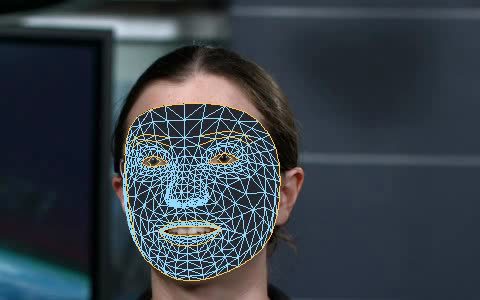
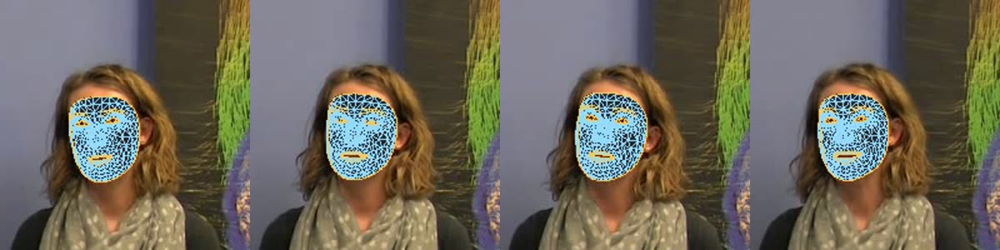
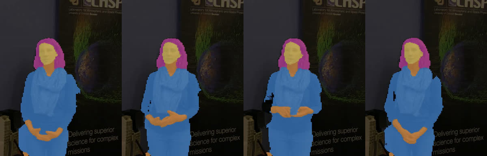
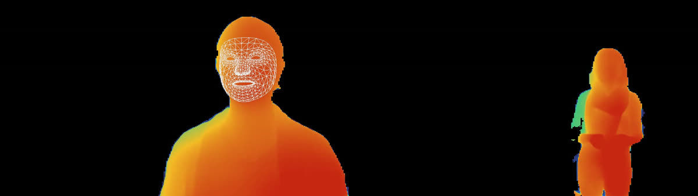

# Spike: face mesh, depth and person mask from Rust (issue #187)

Date: 2026-10-23. Decision: [ADR-0024](../adr/0024-local-vision-models.md). Spec: [`docs/spec/performance-capture.md`](../spec/performance-capture.md).

The spike ran in a 4-core Linux container with no GPU, and on GitHub's `ubuntu-latest` and `windows-latest` runners (4 vCPU, no GPU) through the `vision-spike` workflow. The reference machine (16 cores, RTX 3080 Ti) is measured with the Windows checks on #51. Container numbers move by ±20 % from run to run; read them as shapes, not benchmarks.

## What was built

No app code. `spikes/vision-probe/` is a standalone crate with its own workspace and lock file, so the app's build and tests never compile it. Like the app, it forbids `unsafe`.

| Piece | What it does |
| --- | --- |
| `vision-probe info` | Loads every model on the CPU or DirectML and prints inputs, outputs and where it runs |
| `vision-probe face` | MediaPipe Face Landmarker rebuilt in Rust: BlazeFace short range (SSD anchors, weighted NMS), rotated crop, 478-point mesh, tracking from the last frame's landmarks, 52 blendshapes. Writes `face_landmarks.json` in the spec's format and a video with the mesh drawn over the face |
| `vision-probe mask` | Selfie multiclass segmenter; overlap between consecutive masks and a video with the classes colored |
| `vision-probe depth` | Depth Anything V2 Small per frame (`v2`), the same smoothed over time (`v2-ema`), or Video Depth Anything Small in 32-frame windows (`video`, its window alignment ported from upstream); flicker on the background and a depth-figure video |
| `vision-probe bench` | Face, mask and both depth models on one take, as JSON |
| `tools/convert.py` | Downloads every source pinned by SHA-256 (upstream code by commit), converts the TFLite models with tf2onnx, exports the depth checkpoints with `torch.onnx`, and checks every ONNX file against TFLite or PyTorch |
| `tools/takes.py` | Fetches the two test recordings by SHA-256 and cuts the takes |
| `tools/gen_edges.py` | Writes the mesh's triangles, contours and irises from MediaPipe's own lists |
| `tools/compare_face.py` | Runs MediaPipe's own Face Landmarker on the same video and compares |
| `models.toml` | The draft models manifest |

Run it: `python tools/convert.py models`, `python tools/takes.py takes`, then `cargo run --release -- bench --models models --video takes/take-head-30s.mp4` from `spikes/vision-probe` (the pinned ffmpeg comes from `cargo xtask fetch-ffmpeg`).

## Test takes

Two NASA Goddard interviews (GOLD mission resources, 2018): works of the US federal government, so in the public domain, which allows them in the repository (Decided 3). They are not committed because of their size; `takes.py` fetches them by SHA-256.

- **Head**, 30 s, 1080p30: a seated speaker facing the camera, face about a third of the frame's height. Two answers joined, so one cut at 20.2 s (left out of the frame-to-frame measures).
- **Gestures**, 15 s, 1080p30, one shot: a standing speaker with loose curly hair and hand gestures, face 13 % of the frame's height.

Neither has fast gestures or a hand crossing the face; a take recorded for the purpose, with both, is on the #51 list.

## Figures

1. 
2. 
3. 
4. 

## Runtime

- **`ort =2.0.0-rc.12`** with ONNX Runtime **1.24.2**, linked statically from pyke's builds (`download-binaries`); no `onnxruntime.so` on Linux. Release binary with everything: 32.6 MB on Linux. Windows files are in the CI table below.
- **No `unsafe`** in the probe: sessions, tensors from slices (`TensorRef::from_array_view((shape, &data))`) and outputs (`try_extract_tensor`) are all safe API.
- **DirectML**: registered per session with `error_on_failure`; a session whose DirectML start fails is rebuilt on the CPU and says why, so a missing or broken graphics driver never stops analysis. DirectML also needs memory patterns off and sequential execution.
- **Threads**: the face models are small and run faster on one thread (20.6 ms a frame) than on four (28 ms), from the cost of handing tiny operators between threads. The depth models want all cores.
- ONNX Runtime's CPU kernels are about half as fast as TFLite with XNNPACK on the face landmark model (16 ms against 8 ms a call); `ort`'s `xnnpack` execution provider is the thing to try if the face step ever matters. It does not today (below).

## Converting the models

- **MediaPipe** (`face_landmarker.task` float16 v1: three TFLite files; selfie multiclass float32 v1) through **tf2onnx 1.17**, opset 17. On random input every converted model matches TFLite within 7·10⁻⁴ (landmarks, in pixels of a 256 input) or 10⁻⁴ (the rest).
  - The segmenter's nearest-neighbour upsampling comes out as `Resize` with `tf_half_pixel_for_nn`, deprecated since opset 13 (ONNX Runtime warns). For its 2× upscales that is the same as `asymmetric` with `floor`; `convert.py` rewrites the three nodes and the result still matches TFLite.
  - The landmark model's output is pixel coordinates in its 256×256 input; presence and the detector's scores are logits (sigmoid); the segmenter's output is logits (softmax). Inputs: detector −1..1, landmarks 0..1, segmenter −1..1 with the frame stretched to 256×256 (letterboxing it made the mask worse against MediaPipe's own: IoU 0.87 against 0.97).
- **Depth** checkpoints into their upstream code at a pinned commit, exported with `torch.onnx` (TorchScript exporter), opset 17, fixed input size. The export matches PyTorch within 3·10⁻⁶ of the output range.
  - Video Depth Anything's attention starts from `torch.baddbmm` over an uninitialised tensor with `beta=0`; traced, that tensor became 300 MB of constant zeros (a 411 MB file). `convert.py` swaps in a plain matmul before export: 116 MB, same output.
  - Export needs `torch.no_grad()`: without it tracing Video Depth Anything ran out of 15 GB of memory.
  - Fixed shapes: DINOv2's position embedding is resized from Python numbers, so each input size is its own file (`…_280x504`, and a `…_504x280` for vertical takes).
- **Reproducibility**: the PyTorch exports are byte-for-byte the same on every run; tf2onnx's are not (node names and order change), though they compute the same. So the SHA-256 that matters is that of the files Bardo mirrors, not of a re-conversion; `convert.py`'s checks against TFLite and PyTorch are what make the conversion repeatable.

| File | Size |
| --- | --- |
| `face_detector.onnx` | 0.4 MB |
| `face_landmarks_detector.onnx` | 4.9 MB |
| `face_blendshapes.onnx` | 1.9 MB |
| `selfie_multiclass_256x256.onnx` | 16.5 MB |
| `depth_anything_v2_small_280x504.onnx` | 98.9 MB |
| `video_depth_anything_small_32x280x504.onnx` | 116.3 MB |

## Face mesh

- **Matches MediaPipe.** On the 900 frames of the head take, against MediaPipe's own Face Landmarker (Python task, video mode, same `.task`): both find the face in every frame; landmarks differ by 1.8 px on average (95th percentile 3.5 px, worst 9.2 px) on a face 357 px tall; blendshapes by 0.009 on average. MediaPipe's video mode smooths landmarks over time (a one-euro filter) and the probe does not, which accounts for most of the gap.
- **Small faces.** On the gestures take (face 13 % of the frame's height) neither MediaPipe nor the probe finds a face in any of 454 frames: in the whole frame letterboxed to 128×72, the face is 7 pixels tall, under what BlazeFace short range sees. The probe then searches a square three times the size of the person mask's face-skin pixels: the face is found in every frame (figure 2), and the search ran once (the landmarks track it after that).
- **More than one face.** The detector runs on every frame (2.4 ms) to count faces, as the "one person only" check needs. With a small face it sees none, even while the landmarks track one, so the check must count in the head search's region or in each person-mask region too, not in the whole frame alone.
- **Edges.** MediaPipe's tessellation is 852 triangles (2,556 edges, each triangle's three in order), plus 124 contour edges and 4 per iris. The mesh covers the face from the brows down; **the eyes and mouth are holes** in it, so drawing the triangles filled still shows the performer's eyes and teeth (figure 1). The forehead above the brows and the hairline are outside it too.
- **`face_landmarks.json`** at five decimals is 12.5 MB for a 30 s take. Fine on disk; compress it or store it in binary if takes multiply.

## Person mask

- Hair (curly, loose), hands in front of the body and arms all come out right; figure 3 colors them by class (hair, body skin, face skin, clothes). The edges follow the 256×256 grid (about 4 px of a 1080p frame).
- From frame to frame the person's pixels overlap by 0.991 on average on the gestures take (worst 0.839, one pair under 0.9 in 453) and 0.995 on the head take (worst 0.953, none under 0.9).
- Against MediaPipe's own segmenter on the same frame, the person pixels overlap by 0.97.
- **No SAM-class segmenter.** For one performer near the camera this is enough; the spec's rule stands (only if reviews show masks failing). The fast-gesture take on #51 is the check.

## Depth

All at 280×504 unless noted, on the 4-core container. "Flicker" is the mean change from one frame to the next of the depth mapped to 0..1 (between its 2nd and 98th percentiles), on background pixels (outside the person mask) where nothing moves. "Person" is the same on the person, who does move.

| Model | ms a frame | 30 s take | Flicker, head | Flicker, gestures | Person, head | Peak memory |
| --- | --- | --- | --- | --- | --- | --- |
| V2 Small, per frame | 286 | 4.3 min | 0.0049 | 0.0056 | 0.0055 | 0.3 GB |
| V2 Small, smoothed (each frame aligned to the last, blended half and half) | 283 | 4.3 min | 0.0028 | 0.0031 | 0.0035 | 0.3 GB |
| **Video Depth Anything Small** | 364 | 5.5 min | **0.0009** | **0.0012** | 0.0027 | 4.4 GB |
| V2 Small at 518×924 (150 frames) | 1,100 | 16.5 min | 0.0031 | — | 0.0047 | — |

- Video Depth Anything flickers five times less than V2 per frame and three times less than V2 smoothed, for 1.3× the time. Smoothing V2 trades flicker for lag: it also damps the person's real motion (0.0035 against 0.0055).
- Its cost: 32 frames go through the model at once, and the DPT head's full-size features for all 32 take 4.4 GB of memory on the CPU. At its native 518 lines it did not even export in 15 GB. So 280 lines.
- Each window's first ten frames repeat ten from the window before (frame 0, frame 12 and the last eight), so 22 new frames a window; the output is aligned by a scale and shift fitted on two shared key frames and blended over eight frames. A frame's depth is final eight frames later.
- 518 lines makes V2 four times slower for less flicker than smoothing at 280 gives, and still three times the flicker of Video Depth Anything at 280. The control video's depth figure is a silhouette with shading for the model to follow in build and outline; 280 lines is plenty for that.
- **The figure needs its own normalization.** Colored by the whole frame's range, the person is nearly one color (the background takes most of the range; figure 4). The Depth control video should map depth to colors within the person mask.

## Speed of a whole take

A 30 s 1080p30 take, CPU only:

| Step | Container (4 cores) | `ubuntu-latest` | `windows-latest` |
| --- | --- | --- | --- |
| Decode (ffmpeg, RGB on a pipe) | 3.8 s | — | — |
| Face mesh (detector every frame, landmarks, blendshapes) | 19 s | — | — |
| Person mask | 52 s | — | — |
| Depth, Video Depth Anything Small 280×504 | 5.5 min | — | — |
| Depth, V2 Small 280×504 | 4.3 min | — | — |

So Recording mode needs nothing, Mesh mode about 20 s a take and Depth mode about 6.5 min a take on a 4-core CPU: a job, with progress and cancel, as the spec plans. The reference machine's GPU numbers go with the Windows checks on #51.

## Decisions

See [ADR-0024](../adr/0024-local-vision-models.md). For the slices:

- **#190 (analysis):** the face pipeline as built here, plus MediaPipe's one-euro smoothing (min cutoff 0.05, beta 80); the head search from the person mask; the "more than one face" check in the person regions too. Face models on one thread. Video Depth Anything Small at 280×504 (and 504×280 for vertical takes) where the memory allows (about 4.5 GB free), else V2 smoothed; per-orientation model files. Depth and mask only for Depth mode.
- **#191 (control video):** Mesh mode must fill the eye and mouth holes and cover beyond the mesh's outline (forehead, hairline) so that no frame shows the performer's face; the acceptance test should check for skin-colored pixels inside the face oval. Depth mode colors depth within the person mask.
- **Shipping:** the ONNX files above, about 240 MB in all, mirrored as release assets (`vision-models-1`) and bundled; storing the depth weights as fp16 would halve that and is worth a try in #190.

## Windows-only checks (for #51)

- [ ] `vision-probe info --models <dir> --ep directml` on the reference machine: every model on DirectML, none falling back.
- [ ] `vision-probe bench --models <dir> --video take-head-30s.mp4 --ep directml` and the same with `--ep cpu`: record face, mask and both depth models' ms a frame, and Video Depth Anything's GPU memory (Task Manager, dedicated GPU memory).
- [ ] A take of your own: 20 to 30 s, 1080p, alone, talking with fast hand gestures, a hand passing in front of the face once, turning the head away once. Run `face` and `mask` with `--overlay`: the mesh stays on the face, the mask keeps hair and hands, and the frames where the face is turned away come out without a face.
- [ ] The same take recorded vertical (9:16) on a phone, with `depth --variant video --size 504x280` (after `convert.py --depth-size 504x280`).
